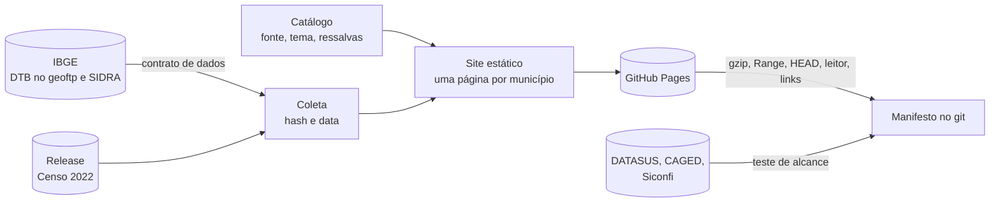

# Explorador de Dados Públicos

[](https://github.com/MatheusCavalcanteF/explorador-de-dados-publicos/actions/workflows/ci.yml)
[](https://github.com/MatheusCavalcanteF/explorador-de-dados-publicos/actions/workflows/publicar.yml)

Site estático e gratuito com dados oficiais de cada município brasileiro, em que cada número mostra de onde veio, quando foi coletado e como conferir na fonte.

**Site:** https://matheuscavalcantef.github.io/explorador-de-dados-publicos/

## O problema

Os dados públicos dos municípios existem, mas cada base mora num sistema diferente, com formato, código de município e armadilhas próprios. Para comparar internações, emprego e educação de uma cidade é preciso passar por um FTP, um `.dbc`, um `.7z` de centenas de megabytes, uma planilha com cabeçalho na linha 10 e uma API por município. E um número copiado de um painel raramente diz de que versão do arquivo saiu.

## A solução

Um pipeline em Python que baixa as fontes oficiais, recusa dado fora do contrato e gera um site estático no GitHub Pages, sem servidor, login ou custo de operação. Cada número na tela abre o painel **Fonte e método**: órgão e pesquisa, link exato para o valor na origem (ou os passos para chegar a ele), período de referência, data da coleta, hash SHA-256 do arquivo coletado e ressalvas.

O plano completo, com as medições que decidiram cada escolha, está em [`docs/plano.md`](docs/plano.md).

## O que já está no ar (etapa F1a)

Publicado em 08/11/2026 pela execução manual [42442355751](https://github.com/MatheusCavalcanteF/explorador-de-dados-publicos/actions/runs/42442355751) do workflow `Publicar`, a primeira no endereço novo:

- Uma página para cada um dos **5.571 municípios** da Divisão Territorial Brasileira 2025 do IBGE, com data-base em 31/12/2025, informada no rodapé de cada página. Cada página traz a população estimada de 2026 e a do Censo 2022. Há busca por nome e listas por estado.
- No painel **Fonte e método**: link exato da API da SIDRA para o valor de cada município, período de referência, data da coleta e SHA-256 da resposta de onde o número saiu, e o arquivo da DTB de onde vêm código, nome e UF.
- Para buscadores: [sitemap](https://matheuscavalcantef.github.io/explorador-de-dados-publicos/sitemap.xml) com as 5.599 páginas, link canônico, Open Graph e JSON-LD do tipo `Dataset` em cada uma, com fonte oficial, licença da base, período e município.
- O Censo 2022 ficou guardado como partição fechada na Release [`ibge-censo-2022`](https://github.com/MatheusCavalcanteF/explorador-de-dados-publicos/releases/tag/ibge-censo-2022). As próximas execuções leem a Release e só a conferem com a fonte; se a fonte mudar, o pipeline para.
- O [manifesto](manifesto/) da execução está no git: arquivos coletados com hash, totais por UF, hash dos valores de cada fonte e o resultado das conferências.

Conferido no site publicado. O CI pediu ao site, em Python e Node, o Parquet da população, a página de Santos e o sitemap: endereço, gzip, `Range`, `HEAD`, sitemap e leitor bateram com o plano, e 30 links exatos sorteados por métrica devolveram o valor publicado. Depois, fora do CI, o sitemap trouxe exatamente as páginas esperadas pela lista de municípios, e o JSON-LD de Santos passou no validador do pipeline com os mesmos valores do Parquet ([`endereco_e_buscadores.json`](docs/medicoes/resultados/endereco_e_buscadores.json)). Em 07/11/2026, ainda no endereço anterior, Chrome 157, Firefox 159 e WebKit 27.2 receberam o Parquet de 225.932 bytes com 116.787 em gzip e o mesmo SHA-256 do build, `Range` voltou `206` com bytes crus, e o leitor em JavaScript leu as 5.571 linhas sem divergência da coleta; esse teste nos navegadores não foi refeito no endereço novo. O build do site tem 5.608 arquivos e 58,1 MB. A página de município tem mediana de 10,1 KB, 3,7 KB deles de JSON-LD; servida em gzip, 3,0 KB numa amostra de 25 páginas.

A publicação semanal foi religada em 07/11/2026, aos domingos às 00:47 UTC. A primeira execução agendada ainda não aconteceu.

## Como funciona



| Parte | Onde | O que faz |
|---|---|---|
| Catálogo | `catalogo/catalogo.yaml` | Temas, bases e métricas, com fonte, tipo de acesso e ressalvas. Validado antes de cada execução |
| Coleta e contrato | `pipeline/dtb.py`, `pipeline/ibge.py` | Acha a DTB mais recente no geoftp e recusa planilha fora da estrutura esperada. Recusa JSON fora do formato, sinal de ausência tratado como número, município fora da DTB e cobertura baixa. Compara o hash dos valores com a coleta anterior |
| Internações do SUS (em preparo) | `pipeline/sih*.py`, `supressao.py`, `deducao.py` | Coleta das 27 UFs no FTP do DATASUS com contrato por linha, tabelas por mês da alta, supressão por família e teste de dedução em cadeia. Ainda não vai para o site: o catálogo marca `publicacao: {site: false, releases: false}`. Precisa de `requirements-sih.txt` |
| Site | `pipeline/site.py`, `web/` | HTML gerado em Python, funciona sem JavaScript; a busca é o único script. O build falha se uma página passar de 100 KB ou um arquivo de 25 MiB |
| Buscadores | `pipeline/buscadores.py` | Sitemap, link canônico, Open Graph e JSON-LD do schema.org (`Dataset`) em cada página, com fonte oficial, licença da base, período e município. O pipeline valida cada bloco e não publica um inválido |
| Endereços | `projeto.yaml` | Única configuração com o endereço do site e do repositório, e o código de verificação do Google Search Console, quando houver |
| Conferências | `pipeline/alcance.py`, `hospedagem.py`, `links.py`, `ferramentas/leitor/` | Rodam no CI depois da publicação. Falha de alcance ou de hospedagem deixa a execução vermelha; link quebrado só fica marcado |
| Workflows | `.github/workflows/` | `ci.yml` roda os testes a cada push; `publicar.yml` coleta, publica e confere toda semana; `alcance.yml`, manual, testa cada fonte passo a passo (DNS, conexão, TLS ou FTP, resposta), inclusive as do roteiro depois da v1, numa tabela à parte; `inep.yml` faz um único pedido por dia ao INEP, de 08 a 14/11/2026, e depois se desliga; `sih.yml`, manual, roda o SIH no runner só para medir tempo, disco e tamanho, sem publicar nada |

**Fontes que o runner não alcança.** Em 07/11/2026, a API de serviços do IBGE (`servicodados.ibge.gov.br`) e o INEP recusaram conexão do runner do GitHub. A coleta não usa mais essa API: a lista de municípios vem da DTB, e a população e o período mais recente, da SIDRA. O INEP só entra na etapa de educação (F1c). Até lá, o `inep.yml` testa se a recusa vem do excesso de pedidos, e o `alcance.yml` só pede ao INEP quando isso é marcado no disparo.

**Revisões do IBGE.** Se a estimativa de população mudar sem mudar o período, a coleta compara com o Parquet que está no ar. O município revisado ganha a ressalva "revisado pelo IBGE", com a data da coleta que detectou, e o [manifesto](manifesto/ibge.json) guarda o valor antes e depois. A publicação não para; variação acima de 5% gera aviso na execução. Um município que a SIDRA traga e a DTB não tenha para a coleta, com erro que diz o código e o que conferir.

**Nome do repositório.** Até 08/11/2026, o repositório se chamava `explorador-dados-publicos`. O GitHub redireciona os links do repositório, mas não os do site: o endereço antigo do site responde 404. Medições e manifestos anteriores guardam o endereço da época.

## Rodar localmente

```sh
python -m venv .venv
.venv/bin/pip install -r requirements.txt     # no Windows: .venv\Scripts\pip
.venv/bin/python -m pytest                    # testes, sem rede
.venv/bin/python -m pipeline coletar --saida build/coleta
.venv/bin/python -m pipeline construir --coleta build/coleta --saida build/site
```

Os testes bloqueiam o acesso à rede e usam dados sintéticos no formato da DTB e da SIDRA. Para publicar em outro endereço, como um fork, basta mudar `projeto.yaml`.

## Dados e licenças

Os dados são do IBGE; o site cita a fonte em cada número. O código está sob licença [MIT](LICENSE). A fonte tipográfica Overpass está sob a [SIL Open Font License](web/fontes/OFL.txt).

O site publica só dados agregados. Nas etapas com dados de saúde e emprego, contagens abaixo de 5 ficam ocultas, com supressão complementar, como descrito no plano.
