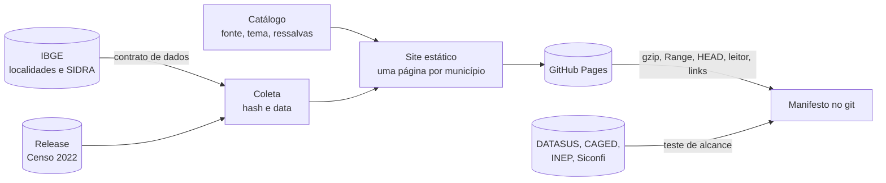

# Explorador de Dados Públicos

[](https://github.com/MatheusCavalcanteF/explorador-dados-publicos/actions/workflows/ci.yml)
[](https://github.com/MatheusCavalcanteF/explorador-dados-publicos/actions/workflows/publicar.yml)

Site estático e gratuito com dados oficiais de cada município brasileiro, em que cada número mostra de onde veio, quando foi coletado e como conferir na fonte.

**Site:** https://matheuscavalcantef.github.io/explorador-dados-publicos/

## O problema

Os dados públicos dos municípios existem, mas cada base mora num sistema diferente, com formato, código de município e armadilhas próprios. Para comparar internações, emprego e educação de uma cidade é preciso passar por um FTP, um `.dbc`, um `.7z` de centenas de megabytes, uma planilha com cabeçalho na linha 10 e uma API por município. E um número copiado de um painel raramente diz de que versão do arquivo saiu.

## A solução

Um pipeline em Python que baixa as fontes oficiais, recusa dado fora do contrato e gera um site estático no GitHub Pages, sem servidor, login ou custo de operação. Cada número na tela abre o painel **Fonte e método**: órgão e pesquisa, link exato para o valor na origem (ou os passos para chegar a ele), período, data de atualização na origem, data e hash SHA-256 do arquivo coletado, e ressalvas.

O plano completo, com as medições que decidiram cada escolha, está em [`docs/plano.md`](docs/plano.md).

## O que já está no ar (etapa F1a)

- Uma página para cada um dos **5.571 municípios** da lista do IBGE, com população estimada de 2026 e do Censo 2022, busca por nome e listas por estado.
- Link exato da API da SIDRA para o valor de cada município, e o hash do arquivo de onde o número saiu.
- Censo 2022 guardado como partição fechada numa Release do repositório: as coletas seguintes leem a Release e só conferem a fonte. Se a fonte mudar, o pipeline para.
- Execução semanal agendada, que também testa se as fontes das próximas etapas respondem do runner (FTP do DATASUS, FTP do CAGED, INEP e Siconfi), confere no site publicado o comportamento de `Range`, `HEAD` e gzip, lê o Parquet publicado com o leitor em JavaScript e confere uma amostra dos links oficiais.
- O resultado de cada execução fica no [manifesto](manifesto/), versionado no git.

Medido no build de 07/11/2026: 5.607 arquivos e 25,9 MB no site; a página de município tem mediana de 4,5 KB. O leitor em JavaScript leu as 5.571 linhas do Parquet sem divergência em relação à coleta.

## Como funciona



| Parte | Onde | O que faz |
|---|---|---|
| Catálogo | `catalogo/catalogo.yaml` | Temas, bases e métricas, com fonte, tipo de acesso e ressalvas. Validado antes de cada execução |
| Coleta e contrato | `pipeline/ibge.py` | Recusa JSON fora do formato, sinal de ausência tratado como número, município desconhecido e cobertura baixa |
| Site | `pipeline/site.py`, `web/` | HTML gerado em Python, funciona sem JavaScript; a busca é o único script |
| Conferências | `pipeline/alcance.py`, `hospedagem.py`, `links.py`, `ferramentas/leitor/` | Rodam no CI depois da publicação. Falha de alcance ou de hospedagem deixa a execução vermelha; link quebrado só fica marcado |
| Workflows | `.github/workflows/` | `ci.yml` roda os testes a cada push; `publicar.yml` coleta, publica e confere toda semana |

## Rodar localmente

```sh
python -m venv .venv
.venv/bin/pip install -r requirements.txt     # no Windows: .venv\Scripts\pip
.venv/bin/python -m pytest                    # testes, sem rede
.venv/bin/python -m pipeline coletar --saida build/coleta
.venv/bin/python -m pipeline construir --coleta build/coleta --saida build/site
```

Os testes bloqueiam o acesso à rede e usam dados sintéticos no formato das APIs do IBGE.

## Dados e licenças

Os dados são do IBGE; o site cita a fonte em cada número. O código está sob licença [MIT](LICENSE). A fonte tipográfica Overpass está sob a [SIL Open Font License](web/fontes/OFL.txt).

O site publica só dados agregados. Nas etapas com dados de saúde e emprego, contagens abaixo de 5 ficam ocultas, com supressão complementar, como descrito no plano.
