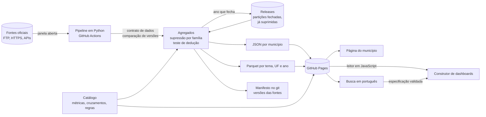

# Explorador de Dados Públicos: plano

Site estático e gratuito para consultar, cruzar e visualizar dados públicos dos municípios brasileiros. Saúde é um dos temas, não o tema.

**O problema.** Os dados existem, mas cada base mora em um lugar, com formato, código de município e armadilhas próprias. Para saber quantas internações os moradores de uma cidade tiveram e comparar com emprego e educação, é preciso passar por um FTP, um arquivo `.dbc`, um `.7z` que abre em cerca de 450 MB, uma planilha com cabeçalho na linha 10 e uma API por município.

**A proposta.** Uma página por município, um construtor de dashboards e uma busca em português, todos sobre a mesma especificação de consulta. Cada número mostra fonte, período, data da coleta e ressalvas. Sem servidor, sem login, sem custo de operação.

Este documento parte do que os dados mostraram. As medições foram feitas entre 06 e 07/11/2026; os scripts e os resultados estão em [`docs/medicoes/`](medicoes/README.md). Estimativa, quando há, está escrita como estimativa.

## O que as medições mudaram

| Premissa inicial | O que foi medido | Decisão |
|---|---|---|
| Começar pelo SIH de SP | Só o arquivo de SP perde 9.174 internações de moradores de SP tratados em outros estados: 0,32% no total, mas 20,9% no pior município, com 506 de 645 municípios afetados | Processar as 27 UFs sempre |
| O Brasil inteiro fica para o fim, por ser pesado | 14,6 milhões de AIHs de 2025 viram 22,9 MB de agregados publicáveis, ou 11,9 MB em transferência. Baixar e converter as 26 UFs fora SP levou 223 s | O Brasil entra na F1 |
| Saúde primeiro, educação no fim | Censo Escolar por município: 0,24 MB por ano, com 4,7% das células ocultas | Educação entra na F1 e deixa claro que o produto não é só sobre saúde |
| Pode cruzar tudo por município e mês | Mês x capítulo da CID oculta 54,1% das células e 7,75% das internações; por trimestre, 38,5% e 2,95% | Lista fechada de cruzamentos, com critério publicado |
| Óbitos por categoria e por mês | Por mês, 49,2% das células ficariam ocultas. Por categoria, até 97,5% dos óbitos somem nas cidades pequenas | Óbito municipal só no total anual |
| Suprimir cada tabela isoladamente basta | Entre tabelas, 113 contagens de 1 a 4 continuavam dedutíveis | Supressão por família, com teste de dedução em cadeia. Com ela, zero |
| A curva de maturação da Baixada vale para o país | Altas processadas no próprio mês: 87% na Baixada, 81,7% em SP, 66,1% no Brasil, 18,6% em RR | Regra por UF no catálogo |
| A API de localidades do IBGE dá a lista de municípios, e a de períodos diz quando a SIDRA mudou | Em 3 execuções, o runner não abriu conexão com `servicodados.ibge.gov.br`, onde ficam as duas. O geoftp e a `apisidra` responderam nas 3 | Lista pela DTB do geoftp, período mais recente pela `apisidra`, mudança detectada pelo hash dos valores |
| HTTP Range resolve o carregamento e o DuckDB-WASM fica no construtor | Primeira carga do motor em 4G lento: quase 1 minuto. Um leitor em JavaScript devolveu os mesmos dados em 72 de 72 comparações, baixando poucas centenas de KB. Ver [Carregamento](#carregamento) | Leitor em JavaScript como padrão; arquivo por UF, sem depender de `Range`; motor fora da v1 |

## Fontes

Cada base foi testada com dados reais. "Licença" descreve o que a própria fonte declara; não é parecer jurídico.

| Base | Acesso | Licença declarada | Formato | Frequência | Revisões | Cobertura municipal |
|---|---|---|---|---|---|---|
| **SIH/SUS** (AIH Reduzida) | FTP anônimo, sem TLS nem hash | Nenhuma no FTP. Site do Ministério: CC BY-ND 3.0 para o conteúdo do site e "licença aberta", creditando a fonte, para dados abertos. Um conjunto do portal consultado declara CC BY | `.dbc` (DBF comprimido), 1 arquivo por UF e mês. 880 MB por ano fora SP | Mensal. 2608 publicada em 16/10/2026; AC e RR ainda ausentes em 07/11/2026 | Últimas 12 competências republicadas de uma vez. Ver abaixo | 5.570 por residência; 3.146 por hospital nas competências de 2025, 3.145 com alta em 2025 |
| **IBGE DTB** (Divisão Territorial Brasileira) | geoftp, HTTPS, um `.zip` por ano, em pasta por ano | Sem termo específico localizado; publicações do IBGE pedem a citação da fonte | `.zip` com planilhas `.ods` e `.xls`. A de municípios tem título, data-base e o cabeçalho na 5ª linha, com código e nome da UF, sem a sigla | Anual. A edição 2025, com data-base 31/12/2025, saiu em 26/03/2026; não há pasta de 2026 em 07/11/2026 | Sem histórico. O nome da planilha muda entre edições, e em 2022 o `.ods` era um `.xls` com outra extensão | 5.571 |
| **IBGE SIDRA** | API REST sem chave (`apisidra.ibge.gov.br`) | Idem | JSON | Anual nas tabelas testadas | A API de períodos informa a data de modificação: Censo 2022 em 07/05/2026; estimativas 2025 e 2026 em 28/08/2026; PIB 2021 a 2023 em 19/12/2025. Ela fica em `servicodados.ibge.gov.br`, que não aceita o runner, então o pipeline detecta mudança pelo hash dos valores | 5.570 no Censo 2022 e no PIB; 5.571 na estimativa 2026 |
| **Novo CAGED** | FTP anônimo, sem TLS | Página do ministério: CC BY-ND 3.0 para o site. A API do portal federal pede chave, então a licença do conjunto não foi lida | `.7z` com TXT em UTF-8, separado por `;`. Em média, 53 MB por mês comprimidos e 447 MB abertos | Mensal. 202609 publicada em 04/11/2026 | Arquivos separados: `MOV`, `FOR` (fora do prazo) e `EXC` (exclusões) | 5.566, mais o código `999999` |
| **INEP Censo Escolar** | HTTPS | Site: CC BY-ND 3.0. O manual cita a Lei de Acesso à Informação e a LGPD | `.zip` com CSV em latin-1, uma linha por escola, 426 colunas | Anual. A última é 2024; 2025 responde 404 | O `.zip` de 2024 mudou em 08/07/2026, em pasta chamada `..._defeso`, sem explicação no manual | 5.570 |
| **INEP IDEB** | HTTPS | Idem | `.xlsx`, com cabeçalho na linha 10 | Bienal. A última é 2023; 2025 não está na URL esperada | Arquivos de 13/08/2024 | Anos iniciais 5.567 (5.432 com nota em 2023); finais 5.568 (5.384); médio 5.559 (5.076) |
| **Siconfi** | API REST sem chave, paginada, uma consulta por município | **ODbL** nos metadados de todas as APIs consultadas (DCA, RREO, RGF, MSC, extrato, entes) | JSON | DCA anual, RREO bimestral, RGF quadrimestral | Relatórios retificados aparecem como `RE` no extrato | 59 de 60 municípios sorteados no DCA 2023, 2024 e 2025 |

### Detalhes que importam

**SIH/SUS**
- A série atual em `.dbc` vai de jan/2008 a ago/2026 (224 competências). A pasta `CSV` traz só um aviso de 2015 dizendo que os arquivos foram retirados "temporariamente", e `DBF` e `XML` param em 2014.
- Há um arquivo `base_aih1.duck` de 12 GB na raiz, de 07/06/2026, sem documentação. Não é usado aqui.
- **Internações por período usam a data da alta**, e os meses vão recebendo o processamento tardio. O arquivo é por competência, então as competências não coincidem com os meses publicados: 4,4% das linhas de 2025 têm alta antes de 2025. A defasagem máxima medida é de 5 meses.
- **Mudança no tamanho do arquivo não significa mudança nos números.** Entre as versões de setembro e outubro de 2026, 2509 a 2602 mudaram de tamanho sem alterar as internações de SP.
- **Republicar pode piorar o dado, e depois corrigir.** Na versão de outubro, 6 estabelecimentos de Santo André com 50 AIHs ou mais sumiram das competências 2605, 2606 e 2607. Em 2605, o município caiu de 3.616 para 1.269 internações (−64,9%). Na direção contrária, Paulínia estava com 111 internações de moradores em setembro e voltou a 507 em outubro.
- **Conferência com o TabNet, por competência:** 150 comparações (5 municípios, 3 competências, 5 medidas, por local de internação e de residência). 132 são idênticas. As outras 18 são todas da capital, em duas competências, com diferença de até 0,04%. A causa não foi identificada. Na queda de Santo André, as 3 competências no TabNet já mostram os valores da versão de outubro.
- **O TabNet não tem o eixo do site.** Seu "Ano/mês atendimento" é a data de internação, como diz a nota técnica ("período correspondente à data de internação do paciente") e como os dados confirmam: em 10 comparações (5 municípios, 2 visões, competências de 2025), 135 de 163 meses batem com a data de internação e só 5 com a data da alta. Fora da capital, são 120 de 121. Por isso, os meses do site não coincidem com os do TabNet, e a tela precisa dizer isso. O que dá para conferir é o conjunto de AIHs: o total das 12 competências coincide em 7 das 10 comparações, e as outras 3 diferem em até 0,02%. **Nenhum número por mês da alta foi conferido em ferramenta oficial.**

**Novo CAGED**
- Somando `MOV` + `FOR` − `EXC` de 2025, dá **26.599.777 admissões, 25.320.279 desligamentos e saldo de 1.279.498**, os três iguais à [apresentação do Ministério do Trabalho e Emprego](https://www.gov.br/trabalho-e-emprego/pt-br/acesso-a-informacao/acoes-e-programas/programas-projetos-acoes-obras-e-atividades/estatisticas-trabalho/novo-caged/2025/dezembro/apresentacao-dezembro-de-2025-1.pdf). O saldo também está no [comunicado oficial](https://www.gov.br/trabalho-e-emprego/pt-br/noticias-e-conteudo/2026/janeiro/novo-caged-brasil-encerra-2025-com-saldo-positivo-de-1-27-milhao-de-empregos-formais). Só com `MOV`, o saldo daria 1.256.997, um erro de 1,8%. A conferência é do total nacional, sem amostra por município.
- O [sumário executivo](https://www.gov.br/trabalho-e-emprego/pt-br/acesso-a-informacao/acoes-e-programas/programas-projetos-acoes-obras-e-atividades/estatisticas-trabalho/novo-caged/2025/dezembro/sumario-executivo_-acumulado-e-dezembro-2025.pdf) do mesmo ministério traz outras admissões e desligamentos (26.599.698 e 25.320.179), cuja diferença não fecha com o saldo que ele mesmo informa. Por isso a referência aqui é a apresentação.
- Nos arquivos de 2025, as declarações fora do prazo chegam em até 12 meses (63,7% no mês seguinte). Um mês só pode ser considerado fechado depois disso, e os recentes aparecem como preliminares.

**INEP**
- Conferência: 47.088.922 matrículas e 179.286 escolas com matrícula, contra os 47,1 milhões e 179,3 mil divulgados. O MD5 declarado dentro do `.zip` confere.
- A linha é por escola, não por pessoa, desde a mudança de 2022. O arquivo inclui escolas paralisadas e extintas.
- As etapas "especial" e "profissional" se sobrepõem às demais: somar todas dá 50,3 milhões. A tabela usa só as que não se sobrepõem (infantil, fundamental, médio e EJA), que somam 45,7 milhões. Elas não fecham no total, e a tela diz isso.

**Siconfi**
- A ODbL pede atribuição e que bases derivadas sejam compartilhadas pela mesma licença. O código segue MIT; os dados derivados do Siconfi saem sob ODbL, em arquivos separados.
- 25 dos 60 municípios não têm "RREO" no 6º bimestre de 2025; 24 deles têm "RREO Simplificado". O tipo de demonstrativo é regra do catálogo.
- No Anexo I-E do DCA, `cod_conta` é `TotalDespesas` em todas as linhas. A função está no texto da coluna `conta`.
- Cada município-ano custa ~340 KB de JSON. O Brasil inteiro seriam 5.570 consultas por ano de referência: ~1,6 h a 1 consulta por segundo (estimativa). A rajada de 15 chamadas sem espera não foi barrada, mas não localizei o limite oficial. Um endpoint de catálogo teve 4 de 10 pedidos em timeout.

**Municípios**
- A lista vem da DTB mais recente do geoftp: o pipeline percorre as pastas de ano, da mais nova para a mais antiga, e usa a primeira que tiver `DTB_{ano}.zip`. Uma pasta com outro `.zip` para o pipeline, em vez de cair para o ano anterior. A sigla da UF não vem na DTB e sai de uma tabela fixa, conferida com o nome da UF.
- Lida pelo pipeline, a DTB 2025 tem os mesmos 5.571 códigos, nomes e UFs da API de localidades, conferido em 07/11/2026 numa máquina local. O mesmo leitor abre as edições 2023 (5.570 municípios, data-base 22/11/2024) e 2024 (5.571, 31/12/2024); a de 2022 é recusada.
- Os códigos do IBGE têm 7 dígitos; SIH e CAGED usam 6. Os primeiros 6 dígitos são únicos nos 5.571 municípios, então a conversão é segura.
- Boa Esperança do Norte (MT, 5101837) existe nas localidades e na estimativa, mas não no Censo 2022, no PIB nem nas internações de 2025.

## Arquitetura



**Pipeline.** Idempotente, com a mesma disciplina do projeto de origem: `.part` até conferir o tamanho, versão da fonte nos metadados, contrato que recusa dado errado. A supressão só é determinística com linhas em ordem fixa, porque os empates são resolvidos pela posição: medido em duas rodadas, as máscaras das 27 tabelas saíram idênticas. O site só é trocado se tudo passar; se algo falhar, a versão anterior continua no ar. Nada sem supressão sai do runner.

**Três caminhos de leitura:**
1. **Página de município:** HTML estático + um JSON. Estimativa para a v1: mediana de 20,6 KB (4,2 KB com gzip).
2. **Construtor:** Parquet por tema, UF e ano, lido por um leitor em JavaScript. Baixa o arquivo inteiro, o que funciona em qualquer host.
3. **Busca:** dicionário de sinônimos e correspondência aproximada, tudo no navegador. Só gera uma especificação, validada no catálogo. A consulta sai de um modelo fixo, e nenhuma consulta livre é gerada.

**Especificação.** Pergunta, gráfico e dashboard usam o mesmo objeto, que também vai para a URL:

```json
{
  "tema": "saude",
  "metrica": "internacoes",
  "filtros": { "municipio_residencia": ["3548500"], "capitulo_cid": ["10"] },
  "periodo": { "de": "2025-T1", "ate": "2025-T4" },
  "grafico": "linha"
}
```

A validação liga a especificação a **um cruzamento pré-calculado, no grão exato**. O navegador nunca soma células de uma tabela suprimida para chegar a outro grão: somar por cima de "<5" daria um total errado e silencioso. Se o cruzamento pedido não existe, a resposta é uma recusa com sugestões.

### Por que leitor em JavaScript, e não motor

Com cruzamentos pré-calculados, a tela só precisa filtrar um arquivo por município e desenhar. Não há junção livre nem agregação nova, porque somar sobre células ocultas é justamente o que não pode acontecer.

**Formato: Parquet sem compressão, com o gzip do host, e leitor sem descompressor.** Medido com a maior tabela testada (residência x trimestre x capítulo, SP):

| | Sem compressão + leitor leve | zstd + leitor com descompressor |
|---|---:|---:|
| Código do leitor, com gzip | 18,6 KB | 94,7 KB |
| Arquivo em transferência, com gzip | 268,6 KB | 259,9 KB |
| Primeira carga: código + arquivo | 287 KB | 355 KB |
| Tempo em 4G lento, CPU 4x | 2,2 s | 2,6 s |
| Pico de memória | 87 a 90 MB | 91 a 95 MB |
| Publicado por ano (15 tabelas, por UF) | 22,9 MB | 11,6 MB |
| Maior arquivo por UF e ano | 488 KB (280 KB com gzip) | 279 KB |
| Igual ao motor | 12 de 12 tabelas inteiras, nos 3 navegadores | 72 de 72 comparações, mais 24 em Firefox e 24 em WebKit |

O preço é ocupar o dobro no site, o que cabe no orçamento. O risco é depender do gzip do host: o GitHub Pages comprimiu `.parquet` nos arquivos testados, e o site real precisa confirmar. Se deixar de comprimir, o formato é um parâmetro do build, e basta voltar ao zstd.

**O motor (DuckDB-WASM) fica fora da v1.** Só volta se uma função concreta provar que precisa dele, por exemplo análise em várias tabelas que o leitor não consiga fazer em tempo razoável. Nesse caso: carregamento sob demanda, só naquela função, vindo do jsDelivr (6,2 a 7,1 MB com brotli, conforme a CDN que atende) em vez do site, porque o arquivo de 35,9 MB passa do limite de 25 MiB por arquivo. O teste de aceitação é o mesmo: dados iguais aos do leitor e tempo medido em 4G lento.

### Hospedagem: GitHub Pages

Limites confirmados na documentação oficial em 07/11/2026: site publicado de até 1 GB, 100 GB por mês de banda (limite flexível), deploy com timeout de 10 minutos, e proibição de uso como hospedagem de negócio. O Cloudflare Pages tem 25 MiB por arquivo e 20.000 arquivos no plano gratuito, sem limite de banda declarado na página.

O que decidiu foi o comportamento medido em navegador real:

| Teste com `Range` | GitHub Pages | Cloudflare Pages |
|---|---|---|
| Chrome 157, Firefox 159, WebKit 27.2 | `206`, bytes crus, tamanho real em `Content-Range` | `200`, arquivo inteiro |
| Amostras | 2 arquivos e 1 Parquet (leitor e motor) nos 3 navegadores | 1 arquivo nos 3 navegadores, mais 3 arquivos `.js` testados fora do navegador, de 4 sites |
| `HEAD` | Devolve o tamanho **comprimido** | Sem `Content-Length` |

O Cloudflare não documenta isso de forma oficial na página de limites; um relato no repositório das ferramentas dele descreve o mesmo. Como o leitor padrão baixa o arquivo inteiro, a escolha não depende mais de `Range`, e outro host continua possível. Confirmar em deploy próprio é a primeira tarefa da F1.

**Cloudflare na frente do GitHub Pages não deve ser usado com `Range`:** em `shell.duckdb.org`, que tem essa montagem, a leitura parcial falha com `No magic bytes found`, porque o tamanho informado é o do gzip em cache.

### Carregamento

**Peso em transferência:** leitor sem descompressor, 18,6 KB com gzip; leitor com descompressor, 94,7 KB; motor, 8,4 MB (8,1 MB do `.wasm` e 241 KB de JavaScript, com 35,9 MB brutos no `.wasm`).

**Dados iguais.** O leitor com zstd devolveu exatamente o mesmo que o motor em 72 de 72 comparações (4 tabelas, 6 municípios, 3 modos), inclusive os 146.671 valores ocultos de uma tabela inteira, e os 24 casos repetidos em Firefox e WebKit também bateram. O leitor leve, no formato escolhido, bateu em 4 tabelas inteiras de SP nos 3 navegadores. No GitHub Pages real, leu um Parquet público inteiro (231.083 linhas) e, por `Range`, o rodapé e as primeiras 1.000 linhas, com o mesmo resultado nos três navegadores.

**O motor não usa `Range` por padrão.** Sem configuração, baixa o arquivo inteiro. Com `forceFullHTTPReads: false`, o GitHub Pages direto entregou **17.934 bytes em vez de 800.249** para a mesma contagem. É mais um motivo para não depender dele.

**Tempos medidos.** Mediana de 3 execuções, sem cache salvo nas linhas de volta. Os arquivos são de residência x trimestre x capítulo, a maior tabela testada.

**Limite da emulação:** nada disso rodou em celular ou no site real. É Chrome em desktop com tela de celular (390 × 844), um servidor local que imita o comportamento medido no GitHub Pages, banda limitada no servidor, e CPU limitada por Job Object do Windows. A limitação de CPU das ferramentas do navegador não alcança workers: a 4x, a thread principal ficou 4,5 vezes mais lenta e o worker não mudou; com Job Object, os dois ficam 3,9 vezes mais lentos a 4x, e 5,9 vezes a 6x. O teto é pessimista quando motor e tela trabalham juntos, porque um celular real tem mais de um núcleo. O antivírus da máquina altera o tráfego do Chrome e não foi desligado. Cada pico de memória inclui cerca de 80 MB da página vazia.

| Cenário | Transferido | Desktop, sem limite | 4G bom (9 Mbps), CPU 4x | 4G lento (1,6 Mbps), CPU 4x | 4G lento, CPU 6x | Pico de memória |
|---|---:|---:|---:|---:|---:|---:|
| JSON do município (Bertioga) | 5,5 KB | 0,15 s | 0,09 s | 0,20 s | 0,20 s | 85 a 88 MB |
| JSON do município (São Paulo) | 7,8 KB | 0,06 s | 0,09 s | 0,21 s | 0,21 s | 86 a 91 MB |
| **Leitor leve + arquivo da UF sem compressão (padrão)** | 287 KB | 0,10 s | 0,56 s | **2,2 s** | **2,2 s** | 87 a 90 MB |
| Leitor com zstd + arquivo da UF | 355 KB | 0,08 s | 0,61 s | 2,6 s | 2,6 s | 91 a 95 MB |
| Leitor com zstd, outra cidade no mesmo arquivo | 0 | 0,02 s | 0,03 s | 0,03 s | 0,03 s | 103 a 108 MB |
| Leitor com zstd + leitura parcial, arquivo do Brasil | 430 KB | 0,10 s | 0,77 s | 3,3 s | 3,4 s | 99 MB |
| Leitor com zstd + ranking nacional (arquivo de 0,77 MB) | 864 KB | 0,22 s | 1,6 s | 6,5 s | 7,6 s | 145 a 147 MB |
| Motor, primeira carga, sem consulta | 8,4 MB (3 arquivos, `200`) | 0,6 s | 11,5 s | **54,9 s** | **56,2 s** | 248 a 323 MB |
| Motor, consulta com `Range`, arquivo do Brasil | 108 KB | 0,55 s | 1,6 s | 2,7 s | 3,3 s | 290 a 323 MB |
| Motor, outra cidade, arquivo do Brasil | 98 KB | 0,02 s | 0,41 s | 1,2 s | 1,3 s | 290 a 323 MB |
| Motor, consulta, arquivo da UF inteiro | 260 KB | 0,57 s | 1,7 s | 3,2 s | 3,8 s | 293 a 323 MB |
| Motor, volta com cache válido | 0, sem pedidos | não medido | 2,6 s | 3,2 s | 4,4 s | não medido |
| Motor, volta revalidando o cache | 0 (3 arquivos, `304`) | não medido | 3,3 s | 3,3 s | 5,1 s | não medido |

As linhas de consulta do motor somam-se à primeira carga dele. O que isso decide:

- **A página de município não precisa de nada além do JSON.** Os dados chegam em 0,2 s no 4G lento. O número considera só os dados: o JavaScript e os gráficos do site ainda entram na conta.
- **Para o construtor, o leitor resolve.** Em 4G lento, 2,2 s e cerca de 90 MB, contra cerca de 58 s (primeira carga + consulta) e cerca de 295 MB do motor. Mesmo o pior caso medido, um ranking lendo o país inteiro, leva 6,5 s.
- **O gargalo do motor é a rede.** CPU 4x e 6x quase empatam na primeira carga.
- **`Range` não compensa a dependência.** Para o motor, lendo o arquivo do Brasil, poupa 0,5 s em relação a baixar o da UF inteiro; para o leitor, leva mais tempo que o arquivo da UF. Grupos de linhas menores também não ajudam: de 50 mil para 2 mil linhas, o arquivo cresce 27%, e a primeira consulta sobe de 108 KB para 176 KB.

**O cenário de volta foi refeito.** A primeira versão deste teste mostrava 53 s e 8,1 MB na visita repetida. Era defeito do teste, medido assim: no contexto anônimo que o Playwright usa por padrão, o `.wasm` volta com `200` em recarga, em navegação nova e em aba nova, porque esse cache em memória guardou arquivos de até 4 MB e não guardou os de 8 MB ou mais. Com perfil em disco, são 0 bytes nos 4 tipos de navegação, inclusive com o navegador reaberto. O efeito é real para quem usa janela anônima, que baixaria o motor inteiro a cada navegação; o arquivo de dados do leitor fica abaixo desse limite.

## CI e histórico

Os dados não entram no git, e o que está publicado não serve de base para recalcular: as tabelas já estão suprimidas, e somar por cima de "<5" dá errado. Guardar agregados sem supressão em lugar público também não pode.

**De onde vem cada período:**

| Período | Origem | Por quê |
|---|---|---|
| **Anos abertos:** contêm meses que ainda podem mudar | Recalculados a cada execução, das fontes | O FTP republica as últimas 12 competências, mas a partição é por ano, então cada ano aberto exige todas as suas competências. Hoje são 20 competências; no pior caso, 28. Estimativa: 540 arquivos e ~1,9 GB hoje, 756 arquivos e ~2,6 GB no pior caso, e de 8 a 11 min de download, a partir de 312 arquivos e 880 MB em 223 s, medidos fora do CI |
| **Partições fechadas:** anos que não mudam mais | Arquivos já suprimidos, guardados em **Releases** do próprio repositório | Só têm dado que já é público no site. Sem limite declarado de total ou banda; cada arquivo abaixo de 2 GiB, até 1.000 por release |
| **Reconstrução:** regra mudou (valor de k, novo cruzamento) | Execução manual que rebaixa tudo das fontes | Estimativa para 2021 em diante: 1.836 arquivos, ~6 GB, ~25 min de download. Cabe nos 14 GB de disco se processar e apagar arquivo a arquivo, e no limite de 6 h por job |

**Quando um mês fecha.** O mês M do SIH fecha quando todas as competências que podem conter altas dele saíram da janela republicada: `M + 5 ≤ última competência − 12`. Em novembro de 2026, com a última competência em 2608, estão fechados os meses até 2503. O ano vira partição fechada quando dezembro fecha. No CAGED, um mês fecha após 12 meses de declarações fora do prazo. A defasagem de 5 meses foi medida só nas competências de 2025; se uma competência congelada mudar de tamanho, o pipeline avisa em vez de ignorar.

**A supressão é por partição.** Cada ano é suprimido sozinho, sem margem que atravesse anos. Assim, uma partição fechada nunca precisa ser recalculada, e não há total de vários anos publicado.

**Se a fonte sumir.** As partições fechadas continuam nas Releases e o site segue no ar. Só a reconstrução fica impossível para o período perdido.

**O que a documentação oficial confirma** (lida em 07/11/2026):

| Item | O que diz | Consequência |
|---|---|---|
| Cache do Actions | Entrada sem acesso há mais de 7 dias é removida (padrão; configurável até 90 dias em repositório público). 10 GB por repositório | Um job mensal encontraria o cache vazio no padrão. **Não é fonte de dados:** nem "cópia em cache" do INEP, nem histórico |
| Agendamentos | Em repositório público, são desativados após 60 dias sem atividade. A documentação não define "atividade" nem diz se commit do próprio workflow conta | O job grava o manifesto no git todo mês, e a página mostra a idade dos dados. **Se o commit do workflow conta não foi verificado** |
| Atrasos | O agendamento pode atrasar, e na carga alta execuções podem ser descartadas, sobretudo na virada da hora | Execução semanal em minuto quebrado, idempotente, com disparo manual disponível |
| Artefatos | Retenção de 1 a 90 dias em repositório público; download exige acesso de leitura | Nada sem supressão vira artefato, nem aparece em log |
| Runner público | 4 CPUs, 16 GB de RAM, 14 GB de disco, 6 h por job | Basta no papel. Não foi executado lá |

**INEP e IBGE.** O ano do Censo vira partição fechada na Release. O job só rebaixa se o `Last-Modified` mudar, e confere o MD5 que vem no `.zip`. Na DTB e na SIDRA, a mudança é detectada pelo hash dos valores (código, nome e UF; valor por município), comparado com o da coleta anterior gravada no manifesto. A data de modificação da SIDRA saiu do contrato, porque vem do `servicodados`, que não aceita o runner. Se essas fontes estiverem fora do ar, o site mantém o que tem e marca a coleta como atrasada. Só uma falha estrutural do SIH impede a atualização, e nesse caso o site anterior continua no ar.

**Manifesto no git.** Um JSON por base com versão, tamanho e data de cada arquivo de origem, totais por UF e competência, e a lista de meses em revisão, com o valor anterior. A comparação de versões lê as tabelas já publicadas no site, então nada sem supressão precisa ser guardado. É o único dado que entra no git, e seu histórico mostra o que mudou.

**Conferência de links.** Uma tarefa agendada do CI, separada dos testes, abre os links oficiais do catálogo e uma amostra dos links exatos, e marca no manifesto os que falharem, com status e data. Um link exato também precisa devolver o valor publicado. Os testes continuam sem rede. Link quebrado não impede a publicação: o painel avisa que o link falhou na última conferência.

### Trava de queda

Medido entre as versões de setembro e outubro de 2026, só em SP, porque é a única UF com as duas versões guardadas. Queda de 30% ou mais, com pelo menos 100 internações:

| Eixo e visão | Pares município-período | Mudaram | Acionaram a trava | Alarmes falsos |
|---|---:|---:|---:|---:|
| Competência, por hospital | 3.555 | 21 | 3 | 0 |
| Competência, por residência | 14.989 | 100 | 3 | 0 |
| Mês da alta, por hospital | 4.014 | 36 | 4 | 0 |
| Mês da alta, por residência | 16.676 | 141 | 4 | 0 |

Todos os acionamentos são de Santo André. "Alarme falso" aqui é queda em que o valor novo condiz com a mediana das competências 2501 a 2508, que não mudaram: não houve nenhum, porque por competência o valor novo ficou de 64% a 72% abaixo dela. Por competência, baixar a base para 20 internações ou subir o limite para 50% não muda a contagem. É uma única republicação, em um único estado: o limite precisa ser reavaliado com mais versões.

Comparar com a própria história, em vez de comparar versões, seria pior: 36 pares que nem mudaram estão abaixo de 70% da mediana.

**A trava age em dois níveis, no eixo publicado.** O município é comparado por mês da alta, que é o que a página mostra; a competência serve para achar a causa. Nos 4 acionamentos por mês da alta, o valor novo também fica abaixo de 70% da mediana.
- **Município e mês: marca, não bloqueia.** O site publica o valor novo, que é o do arquivo oficial mais recente, marcado como "em revisão", com o valor da versão anterior ao lado e fora de variações e comparações. O TabNet já mostra a mesma versão, conferido em Santo André por competência; por mês da alta, ele não tem como confirmar. A marca sai sozinha quando uma versão seguinte volta para dentro do limite. O valor antigo nunca substitui o novo: misturar versões quebra as margens, e o antigo também pode estar errado, como em Paulínia.
- **Publicação inteira: só em falha estrutural.** Queda de 5% ou mais no total de uma UF e competência (a maior medida foi −0,88%), ou arquivo que reprove o contrato. Nesses casos o site anterior continua no ar e um alerta é aberto.

Barrar a publicação inteira por causa de um município teria parado 5.570 páginas por 6 estabelecimentos de uma cidade, e por tempo indeterminado.

## Esquema do catálogo

O catálogo é a fonte de verdade: gera os agregados, valida a especificação, alimenta a busca e escreve as ressalvas na tela. Cada base tem regras próprias.

```yaml
versao: 1

temas:   # lista fixa; o filtro mostra só os que têm métrica publicada
  populacao: População
  saude: Saúde
  educacao: Educação
  economia: Economia
  trabalho: Trabalho
  financas_publicas: Finanças públicas
  agropecuaria: Agropecuária
  assistencia_social: Assistência social
  saneamento: Saneamento
  meio_ambiente: Meio ambiente
  eleicoes: Eleições
  seguranca: Segurança

bases:
  sih:
    nome: Internações hospitalares do SUS
    orgao: Ministério da Saúde / DATASUS
    licenca: { id: nao-declarada-na-origem, atribuicao: "Ministério da Saúde/DATASUS, SIH/SUS" }
    coleta:
      origem: ftp://ftp.datasus.gov.br/dissemin/publicos/SIHSUS/200801_/Dados
      padrao: "RD{uf}{aamm}.dbc"
      colunas: [N_AIH, ANO_CMPT, MES_CMPT, IDENT, CNES, MUNIC_MOV, MUNIC_RES, DIAG_PRINC, DT_SAIDA,
                DIAS_PERM, VAL_TOT, MORTE, ESPEC, CAR_INT, SEXO, IDADE, COD_IDADE, RACA_COR]
      so_para_validar: [N_AIH]     # confere a chave no pipeline e nunca sai dele
      todas_as_ufs: true           # residência depende de internações em outros estados
    tempo:
      eixo: mes_da_alta            # DT_SAIDA, incorporando o processamento tardio
      janela_republicada_meses: 12
      defasagem_maxima_meses: 5    # fecha o mês M quando M + 5 <= última competência - 12
    maturacao:
      meses_padrao: 3
      por_uf: { AL: 6, BA: 4 }
    revisao:
      municipio: { queda_pct: 30, minimo_internacoes: 100, acao: marcar_em_revisao }
      publicacao: { queda_uf_competencia_pct: 5, acao: manter_site_anterior }
    supressao:
      aplica: true
      k: 5
      contagens: [aihs, internacoes]  # oculta se qualquer uma estiver entre 1 e k-1
      nao_publicar: [aihs]            # a diferença entre as duas seria outra contagem pequena
      complementar: true
      familia: true
    ressalvas:
      - Só SUS. Internações particulares e por plano não aparecem.
      - O valor é o pago pela tabela SIGTAP, não o custo do hospital.
      - Os meses são da data da alta. No TabNet, "atendimento" é a data de internação, e os meses não coincidem.

metricas:
  populacao_estimada:
    tema: populacao
    etiquetas: []
    base: ibge_estimativa
    rotulo: População estimada
    fonte:
      orgao: IBGE
      pesquisa: Estimativas da População, tabela 6579 da SIDRA, variável 9324
      acesso:
        tipo: exato     # exato | tabela | arquivo | receita
        url: "https://apisidra.ibge.gov.br/values/t/6579/n6/{municipio}/v/9324/p/{periodo}"
      tabela: "https://sidra.ibge.gov.br/tabela/6579"
  internacoes:
    tema: saude
    etiquetas: []
    base: sih
    rotulo: Internações
    sinonimos: [internação, hospitalização, baixa hospitalar]
    regra: "IDENT = 1"
    fonte:
      orgao: Ministério da Saúde / DATASUS
      acesso:
        tipo: receita
        url: "http://tabnet.datasus.gov.br/cgi/deftohtm.exe?sih/cnv/nrbr.def"
        receita: "Linha: Município; Conteúdo: Internações; Períodos disponíveis: as competências do ano"
    conferencia: { ferramenta: TabNet, medida: "Internações", eixos: [competencia, data_de_internacao] }
  obitos:
    tema: saude
    etiquetas: []
    base: sih
    rotulo: Óbitos hospitalares
    regra: "soma de MORTE"
    cruzamentos: [sih_res_ano, sih_hosp_ano]   # só o total anual
    ressalvas: [Hospitais de referência recebem casos mais graves. A taxa sozinha não mede qualidade.]
  taxa_internacao:
    tema: saude
    etiquetas: [populacao]
    rotulo: Internações por mil habitantes
    formula: "internacoes / populacao_estimada * 1000"
    fontes: [internacoes, populacao_estimada]   # calculada: cada parcela traz a própria fonte
    oculta_se: [internacoes]                     # herda a máscara do numerador

dimensoes:
  municipio_residencia: { base: sih, coluna: mun_res, conversao: ibge6_para_ibge7 }
  municipio_hospital:   { base: sih, coluna: mun_hosp, conversao: ibge6_para_ibge7 }
  faixa_5: { base: sih, valores: [00-14, 15-29, 30-49, 50-69, 70+], aninhada_em: faixa_12 }

cruzamentos:
  - id: sih_res_mes
    dimensoes: [municipio_residencia, mes]
    metricas: [internacoes, dias, valor]
    arquivo: "sih/res_mes/uf={uf}/ano={ano}.parquet"
    margens_publicadas: [municipio_ano, uf_mes, brasil_mes]
    medido: { celulas_ocultas_pct: 0.7, internacoes_ocultas_pct: 0.02, mb_por_ano: 0.55 }
  - id: sih_res_mes_sexo
    mae: sih_res_mes              # oculta na mãe esconde as filhas da mesma chave
    dimensoes: [municipio_residencia, mes, sexo]
    metricas: [internacoes]
    margens_publicadas: [municipio_mes, municipio_ano_sexo]

ambiguidades:
  - gatilho: "em {municipio}"
    opcoes: [municipio_residencia, municipio_hospital]
    padrao: null     # a tela sempre pergunta
```

As margens são declaradas porque são elas que definem o que dá para deduzir. Publicar uma margem nova exige passar de novo no teste.

**Tema e etiquetas.** Cada métrica tem um `tema` principal e `etiquetas` com os outros temas em que aparece. A lista de temas é fixa e fica no catálogo; criar um tema é mudança de catálogo, não de tela. O filtro mostra só temas com métrica publicada e entra na especificação e na URL (`"tema": "saude"`).

**Fonte.** Cada métrica diz como chegar ao número na origem:

| `acesso.tipo` | Quando | O que a tela mostra |
|---|---|---|
| `exato` | A origem tem um endereço que devolve aquele valor | O link, já com município e período |
| `tabela` | O endereço abre a tabela, e é preciso escolher município e período | O link e os filtros a aplicar |
| `arquivo` | O número sai de um arquivo baixado | O endereço do arquivo |
| `receita` | Não há link para o resultado, como no TabNet | Os passos na ferramenta oficial |

Hash e data da coleta de cada arquivo usado vêm do manifesto, não do catálogo: o catálogo diz de onde vem, o manifesto diz o que foi baixado. Quando o número usa muitos arquivos, como o SIH por residência, o painel mostra o resumo e o link para a lista completa. Métrica calculada lista todas as parcelas em `fontes` e a `formula`, e cada parcela traz a própria fonte.

**Célula oculta.** Cada célula oculta traz o motivo: `contagem_pequena` (1 a k−1) ou `complementar` (oculta para impedir dedução). O motivo também é informação para quem tenta deduzir: numa margem com uma oculta de cada tipo e soma 6, a pequena só pode ser 1. Por isso o teste de dedução trata o motivo como público, com a pequena entre 1 e k−1 e a complementar fora desse intervalo, e a regra complementar precisa resistir a isso. O efeito na quantidade de células ocultas ainda não foi medido; é parte da F1b.

## Regras do SIH levadas para o catálogo

As regras vieram do projeto [Dados-Hospitalares-SUS](https://github.com/MatheusCavalcanteF/datasus-etl-baixada-santista) e foram reconferidas com os dados do Brasil inteiro.

| Regra | Evidência |
|---|---|
| Internação = AIH com `IDENT=1`; as de `IDENT=5` são prorrogações | Confere com o TabNet. No Brasil, 135.213 de 14,6 milhões |
| Chave: (`N_AIH`, competência, `IDENT`, `DT_SAIDA`) | Contrato do projeto de origem |
| Dias de permanência somam todas as AIHs; a média divide pelas internações | Confere com o TabNet só somando todas |
| Ticket médio exclui valor zero | 43.934 AIHs com valor zero no Brasil, 98,2% em leitos de saúde mental (especialidade 87) |
| Período pela data da alta, não pela competência nem pela internação | 4,4% das linhas de 2025 têm alta antes de 2025; a defasagem chega a 5 meses. O "atendimento" do TabNet é a data de internação, então os meses não coincidem |
| Consolidação: 3 meses; AL e BA pedem mais | 99,7% no Brasil em 3 meses; AL 97,6%, BA 98,5% |
| Hospital e residência são visões diferentes | 36,4% das internações ocorrem fora do município de residência. 2.424 municípios não têm internação por hospital |
| Residência exige as 27 UFs | Ver a primeira tabela deste documento |
| Cada CNES pertence a um município | Vale para os 4.880 hospitais de 2025 |
| Sexo: `1` masculino; `2` e `3` feminino | Em 2025, só `1` e `3` aparecem |
| Idade por `COD_IDADE` (2 dias, 3 meses, 4 anos, 5 = 100 + idade) | Código fora da tabela é caso residual no país, e vai para "ignorada" |
| Só colunas da lista são lidas | CEP, nascimento e CPFs não saem do arquivo de origem. `N_AIH` serve só para conferir a chave e não chega ao agregado |

A qualidade dos códigos surpreendeu positivamente: nenhum município fora da lista do IBGE, nenhum CID fora do formato, nenhuma data inválida, nenhuma permanência negativa nos 14,6 milhões de registros. As categorias U09 e U10 (30 registros) não constam da tabela CID-10 de 2008.

## Privacidade e supressão

O site publica só agregados. Contagens de 1 a 4 aparecem como "<5", e zero é mostrado como zero.

**A regra tem quatro camadas, e cada uma existe porque a anterior deixou passar algo medido:**

1. **Por métrica.** A célula fica oculta quando as AIHs **ou** as internações estão entre 1 e 4. Decidir só pelas AIHs deixava 2.225 células visíveis com 1 a 4 internações nas 14 tabelas publicáveis, e 720 no fluxo por ano. As AIHs não são publicadas: a diferença entre as duas medidas seria outra contagem pequena.
2. **Complementar, por tabela.** Oculta também o menor valor visível em cada linha marginal que permitiria deduzir: uma só célula oculta com margem visível, ou ocultas somando menos que 5. Isso vale inclusive para o município somado dentro da UF.
3. **Por família, entre tabelas.** Uma célula oculta na tabela-mãe esconde todas as filhas da mesma chave, e a única filha de uma mãe visível não serve de complementar, porque seu valor já é público. Um trimestre herda a ocultação de qualquer mês dele. Faixas etárias precisam ser aninhadas: as de 5 grupos cabem nas de 12, para não permitir subtração.
4. **Teste de dedução.** Age como quem tenta deduzir: parte do que é visível e usa as margens publicadas em cadeia. **Sem família, 113 contagens de 1 a 4 eram dedutíveis; com família e só as margens declaradas, zero.** Se todas as margens fossem publicadas (UF x categoria, por exemplo), sobrariam 157 em hospital x mês x caráter, por isso elas não são publicadas.

**Critério para publicar um cruzamento:** no máximo 5% das internações e 50% das células ocultas, e zero no teste de dedução com as margens declaradas. Tabelas de cauda longa, como fluxo entre municípios, podem passar com recorte (os maiores valores e "demais").

### SIH, Brasil, 2025

A coluna "Internações ocultas" mede internações, não AIHs. Percentuais com todas as margens consideradas na complementar.

| Cruzamento | Linhas | Células ocultas | Internações ocultas | Parquet | Situação |
|---|---:|---:|---:|---:|---|
| Residência x ano | 5.570 | 0,0% | 0,00% | 0,06 MB | Publicar |
| Hospital x ano | 3.145 | 0,1% | 0,00% | 0,04 MB | Publicar |
| Residência x mês | 66.828 | 0,7% | 0,02% | 0,55 MB | Publicar |
| Hospital x mês | 36.862 | 4,0% | 0,05% | 0,31 MB | Publicar |
| Residência x mês x sexo | 133.505 | 6,5% | 0,39% | 0,97 MB | Publicar |
| Residência x ano x capítulo CID | 106.957 | 16,3% | 0,37% | 0,77 MB | Publicar |
| Residência x ano x cor/raça | 22.483 | 25,7% | 0,72% | 0,17 MB | Publicar |
| Residência x ano x faixa etária (12) x sexo | 131.936 | 16,0% | 0,85% | 0,89 MB | Publicar |
| Hospital x ano x especialidade | 10.984 | 11,0% | 0,70% | 0,10 MB | Publicar |
| Hospital x trimestre x capítulo CID | 171.984 | 35,4% | 1,50% | 0,98 MB | Publicar |
| Residência x mês x urgência ou não | 133.018 | 13,4% | 1,60% | 0,92 MB | Publicar |
| Residência x mês x faixa etária (5) | 326.761 | 23,6% | 2,05% | 1,88 MB | Publicar |
| Residência x trimestre x capítulo CID | 380.845 | 38,5% | 2,95% | 1,93 MB | Publicar |
| Hospital x mês x caráter | 58.540 | 13,9% | 4,53% | 0,45 MB | Publicar, sem margem anual por caráter |
| Fluxo residência → hospital x ano | 117.068 | 61,1% | 2,75% | 0,62 MB | Com recorte |
| Hospital x mês x especialidade | 116.828 | 26,3% | 2,55% | 0,75 MB | Fora da v1: 37 valores dedutíveis pelo total anual |
| Hospital x mês x capítulo CID | 429.330 | 44,6% | 3,23% | 2,02 MB | Fora da v1: redundante com o trimestre, e soma com ele permite subtrair |
| Estabelecimento x mês | 55.870 | 5,8% | 1,07% | 0,48 MB | Fora da v1 |
| Estabelecimento x ano x capítulo CID | 70.323 | 24,7% | 4,06% | 0,53 MB | Fora da v1 |
| Residência x mês x capítulo CID | 942.679 | 54,1% | 7,75% | 3,61 MB | **Não** |
| Residência x mês x caráter (3 grupos) | 142.840 | 23,3% | 8,06% | 0,91 MB | **Não** |
| Fluxo residência → hospital x mês | 524.048 | 67,0% | 9,50% | 1,90 MB | **Não** |
| Residência x ano x procedimento | 1.217.371 | 71,5% | 10,55% | 4,31 MB | **Não** |
| Residência x ano x categoria CID (3 dígitos) | 1.485.310 | 73,1% | 13,24% | 5,09 MB | **Não** |
| Residência x ano x capítulo x faixa (5) x sexo | 678.619 | 68,5% | 21,87% | 2,08 MB | **Não** |
| Residência x mês x categoria CID | 4.612.115 | 88,8% | 44,09% | 12,16 MB | **Não** |
| Residência x mês x capítulo x faixa (5) x sexo | 3.296.997 | 92,3% | 54,42% | 5,44 MB | **Não** |

As 15 tabelas publicáveis somam **10,64 MB por ano** nestes arquivos nacionais com zstd; com os totais anuais de óbitos, 10,7 MB. No formato escolhido, por UF e sem compressão, são 22,9 MB, ou 11,9 MB em transferência com gzip. Juntar categorias raras ajuda muito: "caráter" com 3 grupos oculta 8,06%, porque a complementar acaba caindo em células grandes; com "urgência ou não", 1,60%.

**A média nacional esconde as cidades pequenas.** O critério acima olha o país inteiro. Por faixa de população (células ocultas / internações ocultas):

| Cruzamento | Até 5 mil (1.286) | 5 a 20 mil (2.530) | 20 a 100 mil (1.417) | 100 a 500 mil (289) | Mais de 500 mil (49) |
|---|---:|---:|---:|---:|---:|
| Residência x mês | 2,8% / 0,61% | 0,2% / 0,02% | 0% / 0% | 0% / 0% | 0% / 0% |
| Residência x mês x sexo | 22,4% / 10,56% | 2,9% / 0,74% | 0,1% / 0,02% | 0% / 0% | 0% / 0% |
| Residência x ano x capítulo CID | 31,5% / 4,67% | 16,6% / 1,08% | 6,6% / 0,22% | 1,6% / 0,04% | 2,4% / 0,03% |
| Residência x mês x urgência ou não | 36,8% / 24,09% | 10,5% / 5,56% | 0,9% / 0,39% | 0% / 0% | 0% / 0% |
| Residência x ano x faixa etária (12) x sexo | 41,4% / 15,59% | 14,6% / 2,79% | 0,4% / 0,04% | 0% / 0% | 0% / 0% |
| Residência x mês x faixa etária (5) | 60,4% / 33,58% | 21,7% / 6,89% | 1,8% / 0,37% | 0,1% / 0,01% | 0% / 0% |
| Residência x trimestre x capítulo CID | 65,9% / 31,69% | 43,2% / 9,24% | 20,8% / 1,84% | 7,6% / 0,41% | 3,4% / 0,17% |
| Hospital x trimestre x capítulo CID | 72,6% / 27,01% | 50,1% / 9,65% | 28,7% / 2,26% | 13,1% / 0,46% | 4,8% / 0,20% |

Por isso, cada página começa pelo menor nível de detalhe que funciona naquele município: se a visão mensal vier quase toda como "<5", ela abre no ano e oferece o detalhe depois. Sem isso, 68,5% dos municípios, os de até 20 mil habitantes, veriam gráficos cheios de lacunas.

### Óbitos

O caminho anterior, de só trocar 1 a 4 por nulo, não protegia: entre as tabelas por residência, o valor exato era dedutível em 9 casos, e em hospital x ano x especialidade 816 de 3.145 municípios tinham uma única célula nula, que um total publicado revelaria. Foram medidas duas saídas:

| | A: por categoria, com complementar própria | B: só o total anual por município |
|---|---|---|
| Células com óbito oculto | 30,4% a 62,4%, conforme a tabela | 2,6% por residência (144 de 5.570); 11,6% por hospital (364 de 3.145) |
| Óbitos ocultos | 7,1% a 19,5% | 0,07% por residência; 0,15% por hospital |
| Cidades de até 5 mil | 29,7% a 97,5% dos óbitos ocultos | 115 de 1.286 municípios ocultos, por residência |
| Municípios com ao menos metade dos capítulos visível | 11 de 1.284 até 5 mil; 49 de 49 acima de 500 mil | Não se aplica |
| "Sobreviventes" de 1 a 4 deduzíveis | Casos nas tabelas de capítulo, faixa e especialidade | 0 |
| Tamanho | Coluna a mais em cada tabela | 0,05 MB por ano |

**Decisão: opção B na v1.** O total anual responde à pergunta principal em quase todos os municípios, com uma fração do risco. A opção A só serve bem a cidades grandes e multiplica as margens a defender. A taxa de mortalidade segue a mesma máscara do numerador. Por mês, nem o total: 49,2% das células têm de 1 a 4 óbitos e ficariam ocultas antes de qualquer complementar, e só 793 municípios teriam a série inteira.

### Comparação entre versões

A republicação mensal também permite subtrair. Medido em SP, entre setembro e outubro de 2026, por mês da alta: **77 pares visíveis nas duas versões mudaram de 1 a 4 internações por residência (em 56 municípios), e 7 por hospital.** Quem guardar as duas versões descobre essa contagem pequena, ainda que sem detalhe de categoria.

O teste de dedução da F1 inclui essa comparação, sobre o site publicado e a versão candidata, em todos os cruzamentos. Antes de publicar é preciso decidir o tratamento. A alternativa a avaliar é arredondar os meses preliminares para múltiplos de 5, com o valor exato só quando o mês fecha, o que também combina com a natureza provisória do dado. O efeito não foi medido.

### Novo CAGED, Brasil, 2025

**Base desta tabela: só o arquivo `MOV` de 2025.** Linhas, tamanhos e supressão dos cruzamentos não incluem `FOR` nem `EXC`, e a conferência com os ajustes, descrita em [Novo CAGED](#fontes), é só do total nacional. Com os três arquivos, esses números podem mudar, e a F5 precisa medi-los de novo.

O problema é o mesmo, e maior. A regra anterior decidia só pelo total de movimentos e deixava de 7.390 a 225.434 células visíveis com admissões ou desligamentos de 1 a 4, conforme a tabela. Com a regra por métrica e a família:

| Cruzamento | Linhas | Células ocultas | Movimentos ocultos | Parquet | Situação |
|---|---:|---:|---:|---:|---|
| Município x mês | 65.721 | 19,0% | 0,19% | 0,30 MB | Publicar |
| Município x ano x seção de atividade | 70.903 | 38,0% | 0,31% | 0,31 MB | Publicar |
| Município x mês x sexo | 127.354 | 39,2% | 1,14% | 0,42 MB | Publicar |
| Município x ano x subclasse de atividade | 588.508 | 58,1% | 3,34% | 1,90 MB | Com recorte |
| Município x mês x faixa etária | 303.271 | 59,3% | 3,15% | 0,74 MB | Com recorte |
| Município x mês x grande grupo de ocupação | 441.539 | 59,9% | 2,75% | 1,01 MB | Com recorte |
| Município x mês x seção de atividade | 578.672 | 64,0% | 3,60% | 1,35 MB | Com recorte |
| Município x mês x instrução | 456.746 | 66,0% | 3,15% | 0,97 MB | Com recorte |
| Município x ano x ocupação | 994.623 | 72,8% | 5,18% | 2,56 MB | **Não** |
| Município x mês x divisão de atividade | 1.194.336 | 70,8% | 7,15% | 2,50 MB | **Não** |
| Município x ano x seção x sexo x faixa | 441.455 | 78,4% | 9,13% | 0,85 MB | **Não** |
| Município x mês x seção x sexo | 932.445 | 78,8% | 11,38% | 1,58 MB | **Não** |

A F5 deve testar máscara por medida, escondendo só as admissões quando elas forem pequenas e mantendo os desligamentos, o que pode recuperar parte disso. O teste de dedução da F1 ainda não cobre o CAGED.

### Educação, Brasil, 2024

| Tabela | Linhas | Células ocultas | Valor oculto | Parquet |
|---|---:|---:|---:|---:|
| Município x rede x etapa: matrículas | 45.072 | 4,7% | 2,11% | 0,14 MB |
| Município x rede: matrículas | 14.951 | 0,2% | 0,02% | 0,10 MB (as 3 medidas) |
| Município x rede: docentes | 14.951 | 3,1% | 0,45% | |

### Onde a regra se aplica

- **Aplica:** internações, óbitos, emprego, matrículas e docentes.
- **Não aplica:** contas públicas, índices (IDEB), população e contagem de estabelecimentos. PIB e turmas também ficam fora: não são contagem de pessoas.

Os microdados de origem são públicos, e o TabNet mostra contagens pequenas abertamente. A regra protege o que este site expõe e cruza, e é escolha deste projeto: em cidades pequenas, o site vai mostrar menos detalhe que o TabNet.

## Limites de tamanho

Os limites valem para o que é publicado. O orçamento total deixa margem no 1 GB do GitHub Pages.

| Tema | Medido (Brasil) | Janela da v1 | Previsto (estimativa) | Limite |
|---|---:|---|---:|---:|
| SIH, agregados Parquet | 22,9 MB por ano, por UF e sem compressão | 2021 em diante | ~140 MB | 200 MB |
| INEP, Censo Escolar e IDEB | 0,24 MB por ano + IDEB | 2019 em diante | ~5 MB | 20 MB |
| IBGE | < 1 MB | Última + série de população | ~2 MB | 10 MB |
| JSON por município | 113,8 MB (estimativa, 36 meses) | 36 meses | ~115 MB | 200 MB |
| JavaScript do site | Leitor: 18,6 KB com gzip | | Até 2 MB | 5 MB |
| Novo CAGED, agregados Parquet | 7,0 MB por ano nas tabelas aprovadas, só `MOV`, nacional com zstd | 2020 em diante (fora da v1) | ~50 MB com zstd; sem compressão, cerca do dobro | 100 MB |
| Siconfi | Não medido em escala | Fora da v1 | Não estimado | 60 MB |
| **Total** | | | | **595 MB** |

Limites por arquivo:
- **Até 25 MiB para qualquer arquivo publicado, sem exceção.** Mantém a porta aberta para outro host. O `.wasm` do motor tem 35,9 MB e não entra no site; se um dia for usado, vem do CDN.
- **Até 5 MB** para arquivo que o celular baixa inteiro. O maior por UF e ano hoje tem 488 KB, ou 280 KB com gzip (residência x mês x faixa etária, MG).
- **Até 50 KB para o JSON de um município, e 15 KB com gzip.** Estimativa para a v1 com 36 meses: 30,2 KB em São Paulo (8,1 KB com gzip), o maior; mediana de 20,6 KB (4,2 KB). A parte do SIH responde por quase tudo: mediana de 18,7 KB, contra 1,8 KB de educação e 0,1 KB de IBGE.

O pipeline falha se algum limite for passado, e o erro aponta a tabela.

## Reaproveitamento do Dados-Hospitalares-SUS

Mesmo autor, licença MIT. Os arquivos copiados levam uma nota de origem no topo, com o commit `52edc79`.

| Origem | O que fazer |
|---|---|
| `src/dbf_reader.py` e `tests/test_dbf_reader.py` | Copiar sem alteração |
| `src/log_config.py` | Copiar sem alteração |
| `src/extract.py` | Adaptar: `download_file`, `convert_dbc_to_parquet`, `month_range`, `_report_missing`. Tirar o padrão SP, percorrer as 27 UFs, trocar a lista de colunas proibidas por lista de colunas permitidas |
| `src/transform.py` | Adaptar: `_classify_outcome`, `_age_in_years`, decodificações, `validate_trusted`. Sai o filtro da Baixada |
| `src/reference.py` | Adaptar: CID-10 com SHA-256, API do CNES com cache (4.880 hospitais, ~16 min na primeira carga, estimativa) |
| `tests/conftest.py`, `tests/test_transform.py` | Adaptar, **trocando os números de AIH reais por sintéticos** |
| `.github/workflows/ci.yml`, `.github/dependabot.yml` | Copiar como base |
| `src/load.py` | Não copiar o Star Schema. Levar a ideia da conciliação antes de publicar |
| `powerbi/dax_measures.md` | Levar as regras para o catálogo. **Não copiar a tabela de referência**, que traz contagens abaixo de 5 |
| `benchmarks/` | Não copiar. O README de origem já documenta |

## Produtos parecidos

| Produto | O que faz | Limitação observada | Onde este projeto acrescenta |
|---|---|---|---|
| **IBGE Cidades** | Panorama por município com indicadores selecionados, e comparação entre municípios. A API de pesquisas do IBGE lista 94 pesquisas, entre elas "Panorama municipal" | O portal recusou leitura automatizada, então a descrição vem de fontes secundárias e da API, sem exame direto da tela | Séries mensais de saúde e emprego, cruzamentos, dashboard próprio |
| **Atlas Brasil** | IDHM e 78 indicadores municipais anuais. Mapa, tabela, gráfico e ranking | Foco em desenvolvimento humano. Sem dado mensal | Dado mensal, regras de maturação visíveis, busca em português |
| **Base dos Dados** | Tabelas tratadas de muitas fontes, com acesso por SQL no BigQuery, Python e R | A versão aberta tem defasagem de seis meses; dados recentes são para assinantes. O acesso principal pede SQL, Python ou R, e o download direto tem limites. As páginas lidas não citam gráficos | Público que não programa, sem conta, com o dado mais recente disponível |
| **TabNet** | Tabula bases do DATASUS com linha, coluna e conteúdo. Referência para conferir números | Uma base por vez. O resultado sai em tabela, com CSV e TabWin, sem gráfico na página. A consulta é por formulário, sem link para compartilhar. A maturação aparece só como nota genérica ("últimos seis meses"), embora o FTP republique 12 | Cruzamento entre temas, gráfico, link, ressalvas por número. **O TabNet tem mais detalhe, e isso continua sendo verdade** |
| **Dadosfera e UFMG** | Anunciado em outubro de 2025 (CartaCapital, 24/10/2025): consulta em linguagem natural ao DATASUS, 12 meses, protótipos em seis, abertura ao público numa segunda fase | Nenhum lançamento público localizado em 06/11/2026. O site da empresa não mostra o produto | Vários temas, resposta verificável, avaliação de acerto publicada, custo zero de operação |

Pelo que foi possível examinar, nenhum junta os quatro pontos: temas diferentes no mesmo município, sem login, resposta com fonte e ressalva em cada número, e link compartilhável. É o espaço deste projeto. Ele não substitui o TabNet para quem precisa de detalhe nem a Base dos Dados para quem programa.

## Escopo da v1

**Entra (F1 a F3):**
- Página para cada um dos 5.571 municípios da lista do IBGE, com busca por nome.
- SIH (2021 em diante), IBGE (população e PIB), Censo Escolar e IDEB.
- Construtor de dashboards sobre cruzamentos pré-calculados, links compartilháveis, exportação para CSV e PNG.
- Filtro por tema, com só os temas que têm dado publicado. O tema entra na especificação e na URL.
- **Painel "Fonte e método" em todo número, gráfico e dashboard:** órgão e pesquisa, tipo de acesso e link (ou receita), período de referência, arquivos usados com hash e data da coleta, fórmula e parcelas quando a métrica é calculada, motivo de cada célula oculta e as ressalvas. Num dashboard, o painel junta as fontes de todos os gráficos.
- **Exportação que leva a fonte junto:** o CSV tem colunas de fonte, link ou receita, data da coleta e ressalva em cada linha; o PNG traz no rodapé a fonte e o link do estado que o gerou.
- Busca em português com avaliação publicada.
- Arquivos abertos para download, com caminhos estáveis.
- Tema claro e escuro, tabela equivalente a cada gráfico, uso bom no celular.

**Não entra:**
- CAGED, Siconfi e cidades parecidas (próximas fases).
- Diagnóstico por categoria CID de 3 dígitos, procedimento por município e dados por estabelecimento.
- Óbito por mês ou por categoria no município.
- Margens de UF ou Brasil por categoria, até passarem no teste de dedução.
- Consulta livre, qualquer dado individual, login ou servidor.

## Riscos

| Risco | Efeito | O que fazer |
|---|---|---|
| **FTPs sem TLS nem hash** | Não dá para provar que o arquivo é o publicado | Validar a estrutura, comparar versões, registrar tamanho e data da origem |
| **Fontes que recusam o runner** | Medido em 07/11/2026, em 3 execuções do workflow `Alcance das fontes`. A API de serviços do IBGE (`servicodados.ibge.gov.br`: localidades e períodos da SIDRA) não aceitou conexão TCP em nenhuma, nem pelo curl. O INEP aceitou a conexão na primeira e respondeu com reset no TLS; nas outras duas recusou a conexão, também pelo curl, com e sem a chave híbrida no ClientHello. SIDRA, FTP do IBGE, geoftp do IBGE, FTP do DATASUS (um `RD` baixado, com o mesmo SHA-256 da máquina local), FTP do PDET e Siconfi responderam nas 3. Da máquina local, a API do IBGE respondeu nas 3 rodadas; o INEP falhou no TLS nas 3 rodadas completas e respondeu em 5 de 5 tentativas isoladas | Nada da coleta depende do `servicodados`: a lista vem da DTB do geoftp, e a população e o período mais recente, da `apisidra`. Sem a data de modificação, a mudança é detectada pelo hash dos valores. O INEP fica fora do alcance obrigatório do `Publicar` até a F1c e continua no diagnóstico manual. **Hipótese, não confirmada:** bloqueio por excesso de pedidos, porque a primeira execução abriu conexão e as seguintes, feitas minutos depois, não. Testar antes da F1c com o diagnóstico espaçado |
| **Agendamento desativado** | 60 dias sem atividade param a atualização, e a documentação não define "atividade" | Manifesto mensal no git, idade dos dados visível na página, verificação na F1. O commit que altera o `cron` reativa |
| **Fonte republica e piora** | Santo André caiu 64,9% em uma versão | Trava de dois níveis: marca o município, só para tudo em falha estrutural. Limite a reavaliar com mais versões |
| **Dedução entre tabelas** | Sem família, 113 contagens eram dedutíveis. O teste atual é de cadeia, com as margens declaradas, sobre o SIH de um ano | Teste na F1 sobre tudo o que for publicado, em vários anos e temas. Reprovou, não publica |
| **Dedução entre versões** | Em SP, 77 pares por residência revelaram diferença de 1 a 4 entre duas versões | Medir no teste da F1 e decidir o tratamento dos meses preliminares antes de publicar |
| **Comportamento do host muda** | O `HEAD` já informa tamanho comprimido, `Range` depende de detalhes não documentados, e o formato escolhido conta com o gzip do host | Leitor padrão baixa o arquivo inteiro. Teste automático no site publicado. Se o gzip sumir, o build volta ao zstd |
| **Site e TabNet em eixos diferentes** | O site usa a data da alta, e o TabNet, a de internação. Quem comparar um mês vai ver números diferentes e pode achar que é erro | Ressalva junto ao número, explicando a diferença. Conferência pública por competência e por data de internação |
| **Mês da alta sem conferência oficial** | Nenhuma ferramenta oficial testada oferece esse eixo | Conferir as mesmas AIHs pelos outros dois eixos e testar a data da alta no pipeline. Fica registrado como limite |
| **Leitor sem motor de consulta** | Filtrar, ordenar e juntar com população viram código do projeto | Só filtro e desenho sobre cruzamentos prontos; teste de igualdade com o motor no CI, usando-o só como referência |
| **Celular real e iOS sem teste** | Os números são de emulação; WebKit no Windows não é o Safari do iOS | Testar em aparelho antes de lançar a F2 |
| **Licenças ambíguas** | O site do governo declara "SemDerivações" para o conteúdo, sem deixar claro se vale para dados; Siconfi é ODbL | Atribuição em cada número, licença por base, ODbL isolada. Rever antes de publicar os dados para download |
| **Leitura errada** | Mortalidade alta em hospital de referência, só SUS, residência x hospital | Ressalva no catálogo, exibida junto ao número |
| **Limite de banda** | 100 GB por mês | A carga típica tem poucos KB. Com o motor fora, o risco caiu; o maior arquivo por UF transfere 280 KB |
| **Disponibilidade das fontes** | Numa bateria, um endpoint do Siconfi teve 4 de 10 pedidos em timeout. Quedas de conexão vistas no `curl` para o INEP não se repetiram em 20 pedidos em Python, mas o primeiro pedido da coleta de `fontes.json` levou reset, e os outros 11 responderam. A causa não foi identificada, e a máquina tem antivírus que intercepta tráfego | Novas tentativas, e partições fechadas guardadas nas Releases. Reavaliar no runner |
| **Avaliação da busca ruim** | Taxa de resposta errada alta invalida a função | Publicar o número mesmo assim, e recusar mais em vez de errar |

## Fases

As fases originais mudaram com as medições. O que mudou está marcado em **negrito**.

### F1. Páginas por município, em três etapas publicáveis

A divisão proposta (deploy e CI; SIH e catálogo; educação e IBGE) foi mantida, com uma mudança: **o IBGE não pode ser o último**. A página mínima precisa da lista de 5.571 municípios, e o SIH precisa de população para taxas e dos códigos de 7 dígitos. Por isso localidades e população vão para a primeira etapa, e só o PIB fica para a última.

**F1a. Deploy, CI e uma página real**
- Deploy próprio no GitHub Pages; workflow agendado; Release e manifesto no git. Fim de linha fixado em LF no `.gitattributes` antes do primeiro workflow.
- Coleta real pelo runner: lista de municípios pela DTB do geoftp, população pela SIDRA, e um teste de alcance de cada fonte (um `RD` pequeno do DATASUS, a listagem do CAGED, uma consulta do Siconfi). **O INEP saiu do teste semanal até a F1c:** recusou o runner nas 3 execuções do diagnóstico manual, que continua a testá-lo.
- Página de cada município com nome, UF, população, fonte e data da coleta, e o painel "Fonte e método" com o link exato do IBGE para a população.
- Conferência agendada de links, marcando os quebrados no manifesto.
- Repetir no site real os testes de `Range`, `HEAD`, gzip e leitor.

*Pronto quando:* o workflow agendado publica sozinho, as fontes respondem do runner e os testes de hospedagem batem com este plano. Se o runner não alcançar os FTPs, parar e avisar: é o que mais pode mudar o plano.

**F1b. SIH do Brasil, com catálogo e supressão**
- **As 27 UFs**, partições por ano em Releases, janela aberta recalculada.
- Catálogo, contrato de dados, trava de queda, supressão por família.
- **Teste de dedução em cadeia, incluindo a comparação entre versões publicadas e a candidata.** Decisão sobre os meses preliminares.
- Página com gráficos, ressalvas, nível de detalhe conforme o município, filtros.
- **Conferência por mês da alta.** O TabNet não tem esse eixo, então a conferência é em duas partes. Com o TabNet, amostra por município em cada região, nos eixos que ele oferece: competência e data de internação, confirmando que o pipeline parte das mesmas AIHs. No pipeline, teste com AIHs sintéticas de que cada uma cai no mês da sua data de alta, e que os totais fecham entre os três eixos. Investigar a diferença da capital. Procurar outra ferramenta oficial com esse eixo; se não houver, o limite fica declarado na tela.

*Pronto quando:* o teste de dedução dá zero, a amostra bate com o TabNet nos dois eixos dele, os totais fecham com o mês da alta, e o JSON respeita o limite. A meta de abrir a página em menos de 3 s em 4G lento é medida no site real.

**F1c. Educação e o restante do IBGE**
- **Antes de tudo, uma rota do runner até o INEP**, que recusou a conexão em 07/11/2026. Se a hipótese de bloqueio por excesso de pedidos não se confirmar, procurar outra origem oficial dos mesmos arquivos. Sem rota, a educação não entra.
- **Censo Escolar e IDEB**, PIB, amostra conferida com as ferramentas do INEP e do SIDRA.
- O teste de dedução passa a cobrir as tabelas novas.

*Pronto quando:* a página de município mostra saúde, educação e IBGE, cada número com sua fonte. É aqui que o produto deixa de parecer só de saúde. O custo medido é baixo (0,24 MB por ano e 4,7% das células ocultas), então esta etapa pode vir junto da F1b se houver folga.

### F2. Construtor de dashboards
- Especificação na URL, exportação, **leitor em JavaScript sobre arquivos por UF**.
- **Teste de igualdade entre leitor e motor no CI.** O motor só entra na v1 se uma função provar que precisa dele.
- **Publicar os arquivos como dados abertos e documentar os caminhos estáveis**: já são públicos, então isso custa só documentação.
- Teste em aparelho físico e Safari no iOS.

### F3. Busca em português
- Pelo menos 100 perguntas escritas antes de ajustar o sistema, incluindo as sem resposta, com treino e teste separados.
- Dicionário e correspondência aproximada primeiro. Embeddings no navegador só se o ganho compensar o peso.
- Taxas de acerto, recusa correta e resposta errada publicadas no README.

### Depois da v1

**Nesta ordem.** Cada área começa como a Etapa 0: medir a fonte antes de prometer a tela. Não há números estimados aqui, e o acesso de cada fonte ainda não foi testado, salvo CAGED e Siconfi, descritos em [Fontes](#fontes). Em todas, a medição responde às mesmas perguntas: se o runner alcança a fonte, formato e tamanho por ano, cobertura municipal, defasagem e republicação, licença declarada, quanto a supressão oculta em cada cruzamento e com que ferramenta oficial o resultado pode ser conferido.

| Fase | Área | Fonte a medir |
|---|---|---|
| F4 | Saúde ampliada | SIM (óbitos por residência), SINASC (nascidos vivos), CNES (estabelecimentos, leitos e profissionais) e vacinação (SI-PNI), todos do Ministério da Saúde |
| F5 | Trabalho e finanças públicas | Novo CAGED (Ministério do Trabalho e Emprego) e Siconfi (Tesouro Nacional) |
| F6 | Agropecuária | IBGE, Produção Agrícola Municipal (PAM) e Pesquisa da Pecuária Municipal (PPM), pela SIDRA |
| F7 | Assistência social | Ministério do Desenvolvimento e Assistência Social (MDS), dados municipais de Cadastro Único e programas |
| F8 | Saneamento | SINISA, do Ministério das Cidades |
| F9 | Meio ambiente | INPE: desmatamento (PRODES e DETER) e focos de queimada |
| F10 | Eleições | TSE, Portal de Dados Abertos: eleitorado e resultados por município |
| F11 | Segurança | SINESP, do Ministério da Justiça e Segurança Pública |

**F4. Saúde ampliada**
- SIM e SINASC por residência, com a mesma supressão por família do SIH. Óbito por causa tem o mesmo problema medido nos óbitos hospitalares, então a medição começa pelo total anual.
- CNES liga leitos e profissionais ao município do hospital, que o SIH já usa.

**F5. Trabalho e finanças públicas**
- CAGED: `MOV` + `FOR` − `EXC`, máscara por medida, comparação entre cidades parecidas. Refazer tamanho e supressão dos cruzamentos com os três arquivos, porque a medição atual usa só `MOV`. O cruzamento entre saúde e educação já é possível desde a F2.
- Siconfi, com licença ODbL em arquivos próprios.
- Relatório municipal para imprimir.
- **Saem daqui:** SIH do Brasil e INEP (para a F1); dados abertos e caminhos estáveis (para a F2).

**F6 a F11.** Cada área entra quando a medição dela estiver pronta, com seu tema na lista fixa do catálogo.

## Reprodução

Ambiente das medições: Windows 11, Ryzen 7 5700X3D, 32 GB, Python 3.14, DuckDB 2.0.0, Node 24, Chrome 157, com antivírus ativo. Os agregados de 2025 usam a versão dos arquivos disponível em novembro de 2026; para SP, parte vem de cópia de setembro de 2026 cujas competências de 2025 não mudaram nos totais. Tamanhos multianuais são estimados por proporção, a partir de um ano medido.

Veja [`docs/medicoes/README.md`](medicoes/README.md).
