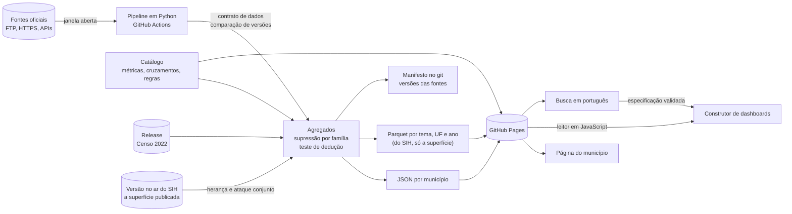

[Índice do plano](../plano.md)

## Arquitetura



**Pipeline.** Idempotente, com a mesma disciplina do projeto de origem: `.part` até conferir o tamanho, versão da fonte nos metadados, contrato que recusa dado errado. A supressão só é determinística com linhas em ordem fixa, porque os empates são resolvidos pela posição: medido em duas rodadas, as máscaras das 27 tabelas saíram idênticas. O site só é trocado se tudo passar; se algo falhar, a versão anterior continua no ar. Nada sem supressão sai do runner.

**Três caminhos de leitura:**
1. **Página de município:** HTML estático + um JSON. Estimativa para a v1: mediana de 20,6 KB (4,2 KB com gzip).
2. **Construtor:** Parquet por tema, UF e ano, lido por um leitor em JavaScript. Baixa o arquivo inteiro, o que funciona em qualquer host.
3. **Busca:** dicionário de sinônimos e correspondência aproximada, tudo no navegador. Só gera uma especificação, validada no catálogo. A consulta sai de um modelo fixo, e nenhuma consulta livre é gerada.

**Especificação.** Pergunta, gráfico e dashboard usam o mesmo objeto, que também vai para a URL:

```json
{
  "tema": "saude",
  "metrica": "internacoes",
  "filtros": { "municipio_residencia": ["3548500"], "capitulo_cid": ["10"] },
  "periodo": { "de": "2025-T1", "ate": "2025-T4" },
  "grafico": "linha"
}
```

A validação liga a especificação a **um cruzamento pré-calculado, no grão exato**. O navegador nunca soma células de uma tabela suprimida para chegar a outro grão: somar por cima de células ocultas daria um total errado e silencioso. Se o cruzamento pedido não existe, a resposta é uma recusa com sugestões.

### Por que leitor em JavaScript, e não motor

Com cruzamentos pré-calculados, a tela só precisa filtrar um arquivo por município e desenhar. Não há junção livre nem agregação nova, porque somar sobre células ocultas é justamente o que não pode acontecer.

**Formato: Parquet sem compressão, com o gzip do host, e leitor sem descompressor.** Medido com a maior tabela testada (residência x trimestre x capítulo, SP):

| | Sem compressão + leitor leve | zstd + leitor com descompressor |
|---|---:|---:|
| Código do leitor, com gzip | 18,6 KB | 94,7 KB |
| Arquivo em transferência, com gzip | 268,6 KB | 259,9 KB |
| Primeira carga: código + arquivo | 287 KB | 355 KB |
| Tempo em 4G lento, CPU 4x | 2,2 s | 2,6 s |
| Pico de memória | 87 a 90 MB | 91 a 95 MB |
| Publicado por ano (15 tabelas, por UF) | 22,9 MB | 11,6 MB |
| Maior arquivo por UF e ano | 488 KB (280 KB com gzip) | 279 KB |
| Igual ao motor | 12 de 12 tabelas inteiras, nos 3 navegadores | 72 de 72 comparações, mais 24 em Firefox e 24 em WebKit |

O preço é ocupar o dobro no site, o que cabe no orçamento. O risco é depender do gzip do host: o GitHub Pages comprimiu `.parquet` nos arquivos testados, e o site deste projeto confirmou em 07/11/2026: o `populacao.parquet` sem compressão, de 225.932 bytes, saiu com 116.787 em gzip nos três navegadores e no teste do CI. Se deixar de comprimir, o formato é um parâmetro do build, e basta voltar ao zstd.

**O motor (DuckDB-WASM) fica fora da v1.** Só volta se uma função concreta provar que precisa dele, por exemplo análise em várias tabelas que o leitor não consiga fazer em tempo razoável. Nesse caso: carregamento sob demanda, só naquela função, vindo do jsDelivr (6,2 a 7,1 MB com brotli, conforme a CDN que atende) em vez do site, porque o arquivo de 35,9 MB passa do limite de 25 MiB por arquivo. O teste de aceitação é o mesmo: dados iguais aos do leitor e tempo medido em 4G lento.

### Hospedagem: GitHub Pages

Limites confirmados na documentação oficial em 07/11/2026: site publicado de até 1 GB, 100 GB por mês de banda (limite flexível), deploy com timeout de 10 minutos, e proibição de uso como hospedagem de negócio. O Cloudflare Pages tem 25 MiB por arquivo e 20.000 arquivos no plano gratuito, sem limite de banda declarado na página.

O que decidiu foi o comportamento medido em navegador real:

| Teste com `Range` | GitHub Pages | Cloudflare Pages |
|---|---|---|
| Chrome 157, Firefox 159, WebKit 27.2 | `206`, bytes crus, tamanho real em `Content-Range` | `200`, arquivo inteiro |
| Amostras | 2 arquivos e 1 Parquet (leitor e motor) nos 3 navegadores | 1 arquivo nos 3 navegadores, mais 3 arquivos `.js` testados fora do navegador, de 4 sites |
| `HEAD` | Devolve o tamanho **comprimido** | Sem `Content-Length` |

O Cloudflare não documenta isso de forma oficial na página de limites; um relato no repositório das ferramentas dele descreve o mesmo. Como o leitor padrão baixa o arquivo inteiro, a escolha não depende mais de `Range`, e outro host continua possível. **Confirmado no deploy próprio em 07/11/2026**, com o Parquet do IBGE, em Chrome 157, Firefox 159 e WebKit 27.2: `206` com bytes crus e `Content-Range` sobre o tamanho real (225.932), também no rodapé do arquivo; `HEAD` com o tamanho do gzip (116.787); e o leitor leu as 5.571 linhas sem divergência da coleta. Fora do navegador há uma diferença: pedindo `Range` com `Accept-Encoding: gzip`, o teste do CI, em Python, recebeu `206` com uma fatia do gzip e `Content-Range` sobre o tamanho comprimido. O Firefox manda `Range` com `gzip, deflate, br, zstd` e recebe bytes crus; o WebKit manda `identity`. Os cabeçalhos de cada pedido estão em [`site_publicado_navegadores.json`](../medicoes/resultados/site_publicado_navegadores.json).

**Cloudflare na frente do GitHub Pages não deve ser usado com `Range`:** em `shell.duckdb.org`, que tem essa montagem, a leitura parcial falha com `No magic bytes found`, porque o tamanho informado é o do gzip em cache.

As medições de 07/11/2026 no site próprio foram feitas no endereço anterior à renomeação, descrita a seguir. O Parquet não mudou de conteúdo, e o CI refez gzip, `Range`, `HEAD` e leitor no endereço novo em 08/11/2026, com o mesmo resultado; nos navegadores, o teste não foi refeito.

### Endereço e buscadores

**Endereço.** O repositório passou de `explorador-dados-publicos` para `explorador-de-dados-publicos` em 08/11/2026, e o site agora mora em https://matheuscavalcantef.github.io/explorador-de-dados-publicos/. O GitHub redireciona os links do repositório, mas não os do site de projeto. Medido às 03:23 UTC, depois da execução 42442355751 do `Publicar`: no endereço antigo, a página inicial, a de Santos e o sitemap responderam `404`, com a página padrão do GitHub; no novo, as três responderam `200`, e um caminho inexistente devolveu a página 404 do próprio site ([`endereco_e_buscadores.json`](../medicoes/resultados/endereco_e_buscadores.json)). Medições e manifestos anteriores guardam o endereço da época.

O endereço do site e o do repositório ficam só em `projeto.yaml`. Link canônico, Open Graph, JSON-LD, sitemap, links do rodapé, a página 404 e a identificação dos pedidos às fontes saem dali, e um teste falha se o endereço aparecer escrito em outro arquivo do pipeline, do site ou dos workflows. A conferência de hospedagem também falha se o deploy publicar em outro endereço.

**O que cada página leva:**
- Link canônico e Open Graph (`og:title`, `og:description`, `og:url`, `og:site_name`, `og:locale`), sem imagem.
- JSON-LD do schema.org, do tipo `Dataset`. A página de município descreve o próprio município (nome, UF e código IBGE em `spatialCoverage`) e tem uma parte por fonte: a DTB, a estimativa e o Censo, cada uma com órgão, citação, licença da base, período de referência, a tabela oficial em `isBasedOn` e o link exato do valor em `distribution`. Município sem dado numa fonte não ganha a parte dela. As páginas de UF e a inicial seguem o mesmo modelo; a inicial também aponta para o Parquet e a lista de municípios.
- A licença sai do catálogo. Nas três bases do IBGE, que não declaram licença, o JSON-LD diz "Licença não declarada na origem", em vez de inventar uma. O catálogo recusa base sem licença, e licença declarada sem endereço.
- O pipeline valida cada bloco antes de gravar (descrição de 50 a 5.000 caracteres, como pede o Google; licença, órgão, fonte oficial, período ISO 8601, link canônico) e não publica um inválido. Nomes com `<`, `>` ou `&` saem escapados dentro do `<script>`.
- A página 404 fica sem link canônico e sem JSON-LD. O host já responde `404`, então `meta robots` não é necessária, e nenhuma página usa.

**Sitemap.** Gerado pelo pipeline em `sitemap.xml`, com as 5.599 páginas: a inicial, as 27 UFs e os 5.571 municípios. O `lastmod` é a data em que a coleta viu pela primeira vez os valores que a página mostra, não a data da execução: toda página é refeita a cada semana, com a data da coleta no rodapé, mas só muda de fato quando um valor muda. Para isso, o manifesto passou a guardar, por fonte, `valores_desde`, e na estimativa também `periodo_desde`. Um município revisado pelo IBGE ganha a data da revisão; os outros, não. Na primeira execução com o registro, todas as páginas ficaram com 08/11/2026, 02:36 UTC, a coleta mais antiga do manifesto. No site publicado, o sitemap tem exatamente as páginas esperadas pela lista de municípios, e o JSON-LD de Santos passou no validador com os mesmos valores do Parquet.

**robots.txt.** O GitHub Pages serve um site de projeto numa subpasta do domínio `matheuscavalcantef.github.io`, e os buscadores só leem `robots.txt` na raiz do domínio, que pertence a um site de usuário, outro repositório. Por isso não há `robots.txt`; o sitemap é enviado direto no Search Console. Decidido em 08/11/2026: o repositório do site de usuário não será criado só para isso, porque o endereço antigo ficou um dia no ar e não foi indexado.

**Google Search Console.** O suporte ao arquivo de verificação está pronto: com o código em `google_search_console`, no `projeto.yaml`, o pipeline grava `google<código>.html` na raiz do site, com o conteúdo que o Google pede. Hoje não há código nem arquivo. A propriedade a cadastrar é a do prefixo de URL do site, e não a do domínio inteiro.

**Peso.** Com o JSON-LD, o site passou de 31,9 MB para 58,1 MB (5.608 arquivos, no build local de 08/11/2026). A página de município foi de 5,6 KB para 10,1 KB de mediana, 3,7 KB deles de JSON-LD. Servida em gzip, a mediana de 25 páginas sorteadas pelo hash do código foi de 3,0 KB; antes, 2,1 KB, noutra amostra de 25. O sitemap tem 817 KB, ou 22,8 KB em gzip.

### Carregamento

**Peso em transferência:** leitor sem descompressor, 18,6 KB com gzip; leitor com descompressor, 94,7 KB; motor, 8,4 MB (8,1 MB do `.wasm` e 241 KB de JavaScript, com 35,9 MB brutos no `.wasm`).

**Dados iguais.** O leitor com zstd devolveu exatamente o mesmo que o motor em 72 de 72 comparações (4 tabelas, 6 municípios, 3 modos), inclusive os 146.671 valores ocultos de uma tabela inteira, e os 24 casos repetidos em Firefox e WebKit também bateram. O leitor leve, no formato escolhido, bateu em 4 tabelas inteiras de SP nos 3 navegadores. No GitHub Pages real, leu um Parquet público inteiro (231.083 linhas) e, por `Range`, o rodapé e as primeiras 1.000 linhas, com o mesmo resultado nos três navegadores.

**O motor não usa `Range` por padrão.** Sem configuração, baixa o arquivo inteiro. Com `forceFullHTTPReads: false`, o GitHub Pages direto entregou **17.934 bytes em vez de 800.249** para a mesma contagem. É mais um motivo para não depender dele.

**Tempos medidos.** Mediana de 3 execuções, sem cache salvo nas linhas de volta. Os arquivos são de residência x trimestre x capítulo, a maior tabela testada.

**Limite da emulação:** nada disso rodou em celular ou no site real. É Chrome em desktop com tela de celular (390 × 844), um servidor local que imita o comportamento medido no GitHub Pages, banda limitada no servidor, e CPU limitada por Job Object do Windows. A limitação de CPU das ferramentas do navegador não alcança workers: a 4x, a thread principal ficou 4,5 vezes mais lenta e o worker não mudou; com Job Object, os dois ficam 3,9 vezes mais lentos a 4x, e 5,9 vezes a 6x. O teto é pessimista quando motor e tela trabalham juntos, porque um celular real tem mais de um núcleo. O antivírus da máquina altera o tráfego do Chrome e não foi desligado. Cada pico de memória inclui cerca de 80 MB da página vazia.

| Cenário | Transferido | Desktop, sem limite | 4G bom (9 Mbps), CPU 4x | 4G lento (1,6 Mbps), CPU 4x | 4G lento, CPU 6x | Pico de memória |
|---|---:|---:|---:|---:|---:|---:|
| JSON do município (Bertioga) | 5,5 KB | 0,15 s | 0,09 s | 0,20 s | 0,20 s | 85 a 88 MB |
| JSON do município (São Paulo) | 7,8 KB | 0,06 s | 0,09 s | 0,21 s | 0,21 s | 86 a 91 MB |
| **Leitor leve + arquivo da UF sem compressão (padrão)** | 287 KB | 0,10 s | 0,56 s | **2,2 s** | **2,2 s** | 87 a 90 MB |
| Leitor com zstd + arquivo da UF | 355 KB | 0,08 s | 0,61 s | 2,6 s | 2,6 s | 91 a 95 MB |
| Leitor com zstd, outra cidade no mesmo arquivo | 0 | 0,02 s | 0,03 s | 0,03 s | 0,03 s | 103 a 108 MB |
| Leitor com zstd + leitura parcial, arquivo do Brasil | 430 KB | 0,10 s | 0,77 s | 3,3 s | 3,4 s | 99 MB |
| Leitor com zstd + ranking nacional (arquivo de 0,77 MB) | 864 KB | 0,22 s | 1,6 s | 6,5 s | 7,6 s | 145 a 147 MB |
| Motor, primeira carga, sem consulta | 8,4 MB (3 arquivos, `200`) | 0,6 s | 11,5 s | **54,9 s** | **56,2 s** | 248 a 323 MB |
| Motor, consulta com `Range`, arquivo do Brasil | 108 KB | 0,55 s | 1,6 s | 2,7 s | 3,3 s | 290 a 323 MB |
| Motor, outra cidade, arquivo do Brasil | 98 KB | 0,02 s | 0,41 s | 1,2 s | 1,3 s | 290 a 323 MB |
| Motor, consulta, arquivo da UF inteiro | 260 KB | 0,57 s | 1,7 s | 3,2 s | 3,8 s | 293 a 323 MB |
| Motor, volta com cache válido | 0, sem pedidos | não medido | 2,6 s | 3,2 s | 4,4 s | não medido |
| Motor, volta revalidando o cache | 0 (3 arquivos, `304`) | não medido | 3,3 s | 3,3 s | 5,1 s | não medido |

As linhas de consulta do motor somam-se à primeira carga dele. O que isso decide:

- **A página de município não precisa de nada além do JSON.** Os dados chegam em 0,2 s no 4G lento. O número considera só os dados: o JavaScript e os gráficos do site ainda entram na conta.
- **Para o construtor, o leitor resolve.** Em 4G lento, 2,2 s e cerca de 90 MB, contra cerca de 58 s (primeira carga + consulta) e cerca de 295 MB do motor. Mesmo o pior caso medido, um ranking lendo o país inteiro, leva 6,5 s.
- **O gargalo do motor é a rede.** CPU 4x e 6x quase empatam na primeira carga.
- **`Range` não compensa a dependência.** Para o motor, lendo o arquivo do Brasil, poupa 0,5 s em relação a baixar o da UF inteiro; para o leitor, leva mais tempo que o arquivo da UF. Grupos de linhas menores também não ajudam: de 50 mil para 2 mil linhas, o arquivo cresce 27%, e a primeira consulta sobe de 108 KB para 176 KB.

**O cenário de volta foi refeito.** A primeira versão deste teste mostrava 53 s e 8,1 MB na visita repetida. Era defeito do teste, medido assim: no contexto anônimo que o Playwright usa por padrão, o `.wasm` volta com `200` em recarga, em navegação nova e em aba nova, porque esse cache em memória guardou arquivos de até 4 MB e não guardou os de 8 MB ou mais. Com perfil em disco, são 0 bytes nos 4 tipos de navegação, inclusive com o navegador reaberto. O efeito é real para quem usa janela anônima, que baixaria o motor inteiro a cada navegação; o arquivo de dados do leitor fica abaixo desse limite.
